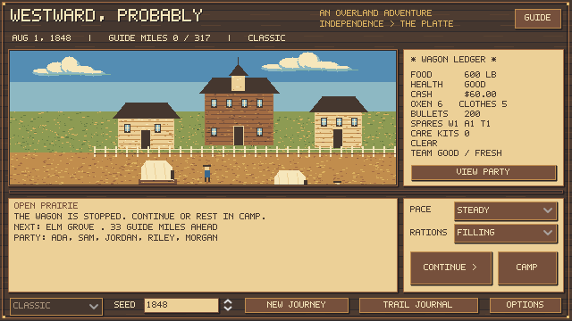

# Westward, Probably

A growing Oregon Trail-inspired game in **Godot 4 / GDScript**. Lead five travelers from Independence to Oregon City, managing supplies, crossings and the Barlow Road. Historical evidence now takes priority when it differs from the classic games. The continuous overland itinerary connects 36 stops over 1,938 reported guide miles. See [route evidence and game comparison](docs/ROUTE_EXPANSION.md).



[Wagon sales, custom robbery demands and resizing](docs/WAGON_SALES_ROBBERY_AND_DISPLAY.md) add reviewed keep/sell/leave decisions, value-sensitive intimidation and configurable window scaling.

[The first hunting balance pass](docs/HUNTING_BALANCE_PASS.md) compares 1,428 journeys and fixes day hunts refusing starving parties. Farmer survival and the led-return time tradeoff remain open.

[Horse loads and wagon hunts](docs/HORSE_LOADS.md) account for riders, tack and freight, with heavy or led returns and an optional noisy whole-party wagon hunt. Deer antlers and rabbit ears now fit their animation cells.

[Hunting trips and mounted outriders](docs/FIELD_OUTINGS.md) use real packed supplies, selected animals and shared carrying rules for leader and companion hunts. Camp > Field trips shows return dates and camps left behind.

[Companion camp work](docs/COMPANION_CAMP_WORK.md) lets travelers nurse, forage, dry meat or help the leader hunt during one shared camp day. [Repairs and named stock guards](docs/CAMP_REPAIRS_AND_GUARDS.md) add persistent broken-part projects and the existing night-watch protection to the roster. Open Camp > Companion tasks to assign standing jobs.

[Nutrition, weak packs and risk](docs/NUTRITION_PACKS_AND_RISK.md) improves scurvy recovery and moderate-illness carrying, and tests brief stops against pushing on. Travel speeds and stop costs are unchanged; riskier choices can shorten journeys.

[The total survival balance check](docs/TOTAL_SURVIVAL_BALANCE.md) covers 4,428 current-mechanics scenarios, historical/current sources and workload-dependent animal condition. Nutrition, weak walking and elapsed journey time remain open; surviving a test journey does not certify historical accuracy.

[Emergency travel and hunting calibration](docs/EMERGENCY_TRAVEL_CALIBRATION.md) corrects meals from a successful hunt before packing, softens the abrupt starvation clock and revises walking/packing pace. Matched emergencies improve, but weak walkers and low-budget pack journeys remain difficult.

[Historical accuracy and mount balance](docs/HISTORY_AND_MOUNT_BALANCE.md) records 1,112 journeys under the preceding rules, dated sources and unresolved pack-travel problems. Passing software tests does not mean these modes are balanced.

[Horses and mules](docs/HORSES.md): the wagon is now an Independence store item, and parties can leave as packers with saddle horses, pack mules and tack. Riding is faster than a wagon but carries far less; doubling up is a short, punishing dash.

[Returning east, replacement wagons and wagon guards](docs/RETURN_TRAVEL_AND_WAGON_GUARDS.md) let an expedition retrace its road, inspect a marked cache and discover the fate of companions left behind. Party creation includes Generate Party.

[Variable bandit demands](docs/BANDIT_DEMANDS.md) can ask for cash, actual carried goods or rarely the loaded wagon, with terms fixed before choosing.

[Wanted encounters and frontier sentences](docs/WANTED_SYSTEM.md) build on witnessed crimes and spreading news, with regional pursuers, rewards, escape choices and save-compatible trials.

[Historically scaled wages and economy](docs/HISTORICAL_ECONOMY.md) now distinguish cash plus party food from unboarded labor, with period price anchors and an explicit list of remaining abstractions.

The [current combined balance pass](docs/CURRENT_BALANCE_PASS.md) covers foraging, produce, recruitment and wanted encounters. [Fresh and dried produce](docs/PRODUCE_AND_NUTRITION.md) can be bought during initial outfitting and at trail counters.

The [full survival campaign](docs/BALANCE_CAMPAIGN.md) records the matched development/validation matrix, policy fixes and remaining [human playtest](docs/PLAYTEST_CHECKLIST.md).

[Food value and hauling](docs/FOOD_VALUE_AND_HAULING.md) separate food units from meat weight and make hunting, walking and carried loot depend on health, injuries and willing helpers.

[Seasonal pressure](docs/SEASONAL_PRESSURE.md) now makes autumn delays and winter roads, grazing and blizzards consequential, with warnings before long rests.

The [food-cost investigation and matched survival diagnostic](docs/HISTORICAL_COST_AND_SURVIVAL_AUDIT.md) records the five-cent departure food estimate, unchanged starting funds and remaining calibration work.

The [historical balance baseline](docs/HISTORICAL_BALANCE_BASELINE.md) compares the current food, travel, team and money rules with dated evidence before the full balance campaign.

The [crime, cannibalism and survival balance roadmap](docs/CRIME_AND_CANNIBALISM_ROADMAP.md) defines the next implementation sequence, acceptance gates and final balance campaign.

The [first store action slice](docs/STORE_CRIME_SLICE.md) is playable at Fort Bridger. [Claude handoff](docs/CLAUDE_HANDOFF.md) records the tested checkpoint and remaining roadmap.

## Play on this computer

Companions have traits, backgrounds, trust in your leadership and memories of selected decisions. View Party shows these beside their health records. The [party framework](docs/PARTY_FRAMEWORK.md) also supports action boundaries, relationships, Stoic's reduced hardship losses and Loyal's lower departure threshold and explicit mercenary wage agreements; the [departure party editor](docs/PARTY_SETUP.md) lets you choose these before setting out. [Creation limits and flaws](docs/PARTY_FLAWS.md) allow two specials per companion, or three with one real drawback. [The expanded character catalog](docs/CHARACTER_CATALOG.md) provides eight temperaments, eight value systems, sixteen specials, twelve flaws, thirteen relationships and reproducible candidate generation for future recruits. Generated companions can be found at eligible stops and emigrant camps when a slot is empty; accepting them preserves the history of departed or dead travelers.

[Background benefits and companion news](docs/BACKGROUND_BENEFITS.md) now add practical hunting, repair, care and purchase benefits, a bounded Veteran combat bonus, visible objections and trust warnings. No skill progression is required.

[Companion consequences](docs/COMPANION_CONSEQUENCES.md) add refusal and warned departures at settlements, with an explicit belongings review. Free companions rely on relationships and decisions; paid companions can build trust by honoring wages, but carry a recurring budget obligation. Payment rewards are normalized across daily/weekly schedules.

Double-click **launch.cmd**. The official portable Godot 4.5.1 runtime downloaded for development is in `.tools/godot/` (ignored by Git). Before starting, it runs **update.cmd**, which fast-forwards a clean `master` checkout to GitHub's `master`. It skips the update on another branch or when tracked files have local edits, and plays the copy already there if the pull fails. Run update.cmd by itself to update without playing.

Alternatively, import `project.godot` in [Godot 4.5.1](https://github.com/godotengine/godot/releases/tag/4.5.1-stable) or a compatible later Godot 4 release, then press **F5**. On another computer, install Godot yourself; the runtime is not part of the repository. No addons, paid assets, or export templates are needed to play from the editor.

1. Name five travelers, customize the four companions in the scrollable panel, choose a profession and departure month, then click **Enter the Store**. Choose supplies and click **Depart**. **Party** returns to setup without losing your cart or charging a purchase.
2. Set pace and rations. Click **Continue** to travel automatically or **Pause** to stop. **Camp** lets you type 1–30 rest days, then confirm. Daily meals, spoilage, weather and health still apply; events, health news or new food warnings interrupt the rest. The same prompt is available at stops.
3. Encounters stop travel. Resolve them, then click Continue when ready. Guide and Journal also pause the wagon. Unaffordable choices are disabled.
4. Use **Save / Load** on the bottom bar to keep a journey and resume it paused. The previous save remains as a backup.
5. Use **Party** to inspect travelers. The right ribbon groups actions under **Travel**, **Supplies**, **Hunt & Forage**, **Villainy** and **History**. **Options** holds display and automatic-travel preferences. Clothing protects against exposure; working the team without rest slows it down. Hunt between landmarks: **left-click fires, right-click walks**. Cover blocks shots; animals flee and the rifle needs reloading. See [hunting](docs/HUNTING.md).
6. Follow the Platte, Fort John/Laramie, South Pass, Bridger, Hall and Boise, then cross the Blue Mountains and take the Barlow Road to Oregon City. Rest and resupply at stops before continuing. The suggested outfit includes 1,700 lb of food; plan additional provisions for the full journey. The journey ends if no one survives. You can then **Leave a Gravestone** with your own epitaph; later journeys can find it. A companion you bury on the trail can get a stone of their own.

One continuous southern/Barlow itinerary is playable; Greenwood’s Cutoff, the Walla Walla detour and Columbia rafting offer alternative roads. Classic contains only historical-style content. Reusing a seed **and the same decisions** repeats the run on the tested Godot version. [The mechanics ledger](docs/MECHANICS_LEDGER.md) identifies verified source behavior, provisional tuning and missing classic systems.

The experimental absurd-event code and sprites remain available for future development and regression tests, but the player interface currently starts Classic only. Set a seed and click **New Journey** to return to outfitting. The priority is completing the classic survival loop before extending the unusual examples.

## What's playable

- Original Western pixel art: wood-and-parchment menus, a bitmap font, prairie/river backgrounds, eight-frame wagon and oxen animation, and matching encounter sprites. All pixels are authored directly in code and exported as PNG assets.
- Illustrated town preparation, store interior, resting camp and every current landmark. [Dated visual references](art/LOCATION_REFERENCES.md) separate archival pictures, museum comparisons, written evidence and interpretation.
- Scrolling ground and slower-moving distant scenery during travel; paused and arrival views stay still. Ford, float and ferry choices play distinct, skippable crossing animations before returning to paused travel.
- Crossing mishaps show cargo washing away, then an acknowledgement screen with exact food losses and an injury report. Dated crossing outcomes remain in the trail journal and structured simulation history; ordinary daily rations are separate from accident losses.
- Daily travel, three paces, three ration levels, food consumption, aggregate party health, rest, victory and loss.
- View Party shows each traveler's condition, illnesses/injuries and personal history, including recoveries and deaths. Survivors continue and food demand follows their number. Party condition stays verbal; [health tuning](docs/PARTY_HEALTH.md) remains provisional rather than recovered classic formulas.
- Five named travelers; banker/carpenter/farmer setup and March–August departure. Opening store sells oxen, food, clothing, ammunition, fresh produce, dried fruit and three distinct spare components, with budget validation and exact-cent purchase totals.
- Optional care/repair kits, paid local care at selected stopped posts, mild/bad/serious individual conditions, and care history.
- Daily seasonal weather affecting progress, exposure and river stage; clothing, team size/condition/fatigue, load and terrain affect the trip.
- Total cargo weight, fresh-meat spoilage, variable hunting yields, ammunition use, trail purchases/sales/barter and repeatable JSON survival encounters. See [food and survival](docs/FOOD_AND_SURVIVAL.md).
- Manual saves with a previous-file backup and persistent player-authored gravestones. See [saving and memorials](docs/SAVES_AND_GRAVESTONES.md). See the [BASIC survival benchmark](docs/BASIC_SURVIVAL_BENCHMARK.md) for coverage and intentional adaptations.
- Automatic Continue/Pause travel with daily updates; encounters, the river and terminal states stop the wagon. Resting or changing settings pauses travel too.
- A JSON corridor with landmark stops, per-leg mileage, river decisions and an explicit chapter ending. River scenery appears near crossings.
- A documented period $1 Kaw ferry fare and no post-1848 Marshall ferry. Assigned low/high water changes the relative risks of fording and floating; numerical odds remain game tuning.
- Parked experimental JSON examples and sprites are retained for a later optional mode.
- Mouse controls, journey seed, field guide, trail journal and restart.

This is a complete playable overland corridor with provisional balancing. Guide miles are estimates from Palmer's 1847 publication, not surveyed lengths. Optional route branches and Columbia rafting are playable; scoring remains future work. Regional weather, forage, trading schedules, stock and survival formulas are authored gameplay models requiring further historical and player calibration. See [historical accuracy](docs/HISTORICAL_ACCURACY.md).

The [first source-grounded balance pass](docs/BALANCE_PASS_01.md) records BASIC/historical comparisons and deterministic before/after experiments. Cautious movement now averages about 12.1 miles per moving day in that experiment. Rest recovery depends on rations; spontaneous illness no longer causes fractures; automatic cholera onset respects the later epidemic chronology. These are starting bounds and corrections, not final historical calibration.

Starting cash is $675/$975/$1,475 for farmer/carpenter/banker. The $75 wagon is now an explicit store purchase; household gear is included. These are gameplay budgets, not measured occupational wealth. Opening oxen cost $30 each, and one-ox departures are allowed with severe hauling limitations. These are period-informed game choices; see [economy and preservation](docs/ECONOMY_AND_PRESERVATION.md) and [team rules](docs/TEAM_SIZE.md).

## Test

From PowerShell in this folder:

```powershell
.\test.ps1
# If your Godot executable is elsewhere:
.\test.ps1 -Godot 'C:\path\to\Godot_console.exe'
```

On any platform with Godot installed:

```text
godot --headless --path . --editor --import
godot --headless --path . --script tests/test_simulation.gd
godot --headless --path . --script tests/test_route.gd
godot --headless --path . --script tests/test_art.gd
godot --headless --path . --script tests/test_ui.gd
godot --headless --path . --script tests/test_motion.gd
godot --headless --path . --script tests/test_health.gd
godot --headless --path . --script tests/test_survival.gd
```

Tests use the real engine and UI scene. They cover accounting, setup, calendars, repairs, action locks, validation, deterministic replay, rare content, **1,000 legacy short-leg regressions, 60 explicit opening-chapter fixtures and 12 prepared-party journeys through Oregon City**. Route checks compare the primary distance-table rows as well as connections, stop order, crossings, terminal states, bulk trading, the Barlow toll/descent and western save continuation. UI tests exercise actual widgets and timers. To regenerate previews with a display available:

```text
godot --path . --script tests/test_ui.gd -- --capture
godot --path . --script tests/test_motion.gd -- --capture
godot --path . --script tests/test_health.gd -- --capture
godot --path . --script tests/test_survival.gd -- --capture
godot --path . --script tests/test_full_trail.gd -- --capture
```

## Project map

| Path | Responsibility |
| --- | --- |
| `simulation/trail_engine.gd` | Node-independent simulation, seeded RNG, state transitions |
| `simulation/route_catalog.gd`, `data/route.json` | Validated continuous itinerary and source-linked mileages |
| `art/western_locations.gd` | Original western arrival/travel art |
| `simulation/event_catalog.gd` | JSON loading and validation |
| `simulation/route_catalog.gd`, `data/route.json` | Validated corridor, landmark descriptions, reported distances and source rows |
| `simulation/outfitting.gd`, `data/outfitting.json` | Profession budgets, shop data and integer-cent quotes |
| `simulation/survival_rules.gd`, `data/survival_rules.json` | Validated weather, seasonal chance, movement, event cooldowns and trade lots |
| `simulation/party_health.gd`, `data/health_conditions.json` | Individual conditions, severity, recovery, death and personal records |
| `data/trail_events.json` | Repeatable survival encounters and constrained choices |
| `data/events.json` | Encounter text, eligibility and choice effects |
| `ui/main.gd`, `ui/main.tscn` | Mouse interface; forwards commands to simulation |
| `ui/trail_view.gd` | Original procedural pixel illustration and animation |
| `ui/departure_view.gd` | Party, month, profession and opening-store interface |
| `simulation/hunting.gd`, `data/hunting.json` | Seeded habitat encounters, movement, cover, reload and animal behavior |
| `ui/hunt_view.gd` | Original pixel hunting scene and mouse controls |
| `ui/location_scenes.gd`, `data/location_scenes.json` | Cached location-art registry, independent of simulation rules |
| `art/location_art.gd`, `art/LOCATION_REFERENCES.md` | Original scene illustrations and dated reference notes |
| `art/build_art.gd`, `art/pixels/` | Reproducible pixel art and exported sprites/font |
| `tests/` | Simulation and scene integration checks |
| `docs/RESEARCH.md`, `docs/MECHANICS_LEDGER.md` | Research narrative and rule-by-rule evidence |
| `research/` | Download recipe, source hashes and ignored local source library |
| `docs/CONTENT.md` | Event format and extension instructions |

Local Git repository initialized. Nothing has been published to GitHub. Third-party research downloads are kept in ignored `research/local/`, separate from game assets and distributable source. The Godot runtime is separately licensed by its authors. See [LICENSE](LICENSE) for this project's original code and content.

The [full-trail balance experiment](docs/FULL_TRAIL_BALANCE.md) archives 2,700 automated journeys and a current mechanics-coverage matrix. That archived diagnosis is followed by the [economy and preservation pass](docs/ECONOMY_AND_PRESERVATION.md): period-informed starting staples and budgets, drying, optional salt, lighter dried cargo, and 3,600 matched journeys including a new-seed sample. Farmer survival is now demonstrably viable under tested strategies; difficulty and history still need human and regional calibration.

The screen renders at **800 × 360** and starts at a crisp **2× scale** (1600 × 720), falling back to 1× on smaller displays. Resize using whole-pixel multiples; spare window space is letterboxed. [Art notes](art/README.md) describe the palette, animations and rebuild procedure. The trail journal opens from the bottom toolbar; use **Travel** to adjust pace/rations and hover for their resource effects.

[Oxen and emergency camp meat](docs/OXEN_AND_CAMP_MEAT.md): replacement animals, grazing assumptions, one-bullet slaughter or risky hand tools, full usable meat recovery and remaining-team consequences.

[Walking and wagon recovery](docs/WALKING_AND_RECOVERY.md): single-ox hauling, reduced small-team load guidance, optional slaughter of the last ox, limited walking packs, cached supplies and risky physical backtracking.

[Team size and emergency survival](docs/TEAM_SIZE.md): four oxen as the baseline, a capped five/six-animal speed bonus, matched bonus/no-bonus journeys, walking abandonment, last-animal slaughter and real cache-return scenarios.

[Regional travel, scarce trading and stop activities](docs/REGIONAL_TRAVEL.md): regional weather and grazing strain, passing trading windows, finite stock/demand, original conversations, grazing camps and crossing preparation. Open **Local Activities** below the scene, or the contextual **Store / Talk to traders** button.

[Care access, dangerous defense and the recent-save review](docs/CARE_COMBAT_AND_SAVE_REVIEW.md): location-bound paid care, party condition and capped defense experience, serious/fatal wounds, and spoilage-aware low-food pauses.


[Foraging and unarmed attacks](docs/FORAGING_AND_UNARMED.md) add seasonal greens/berries, vitamin C from food actually eaten, and a higher-risk unarmed choice even when bullets are available. The map supports scroll zoom, drag panning, FIT and WAGON controls.

[Companion relationships](docs/PARTY_SOCIAL.md) are editable before departure through PARTY RELATIONSHIPS. Friendships, rivalries and romances can develop on the trail; active partners plan warned settlement departures together. View Party shows their feelings and recent social memories.

[Traveler appearance](docs/TRAVELER_APPEARANCE.md) adds editable skin, hair, clothes, outfit and personal heritage, with a live sprite preview. Generated companions receive varied looks; View Party portraits, walkers, hunters and river figures reflect their appearance. Use EDIT > Appearance & Personal Background, or LOOK for the leader.

Companion vacancies, generated recruits and nonviolent dismissal: see [Recruitment and dismissal](docs/RECRUITMENT_AND_DISMISSAL.md). Use **View Party > Ask to leave**, or the contextual **Find companions** button below the scene at populated stops.

See [Action ribbon and preferences](docs/ACTION_RIBBON.md) for the expanded layout and menu tree.

**Camp** opens a camp location and optional activities without spending time. Choose rest, preservation or care inside; Continue resumes the trail. **Supplies** opens inventory directly, with Drop supplies and Abandon wagon actions at the top.
