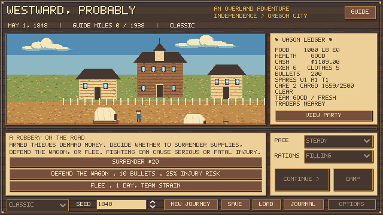
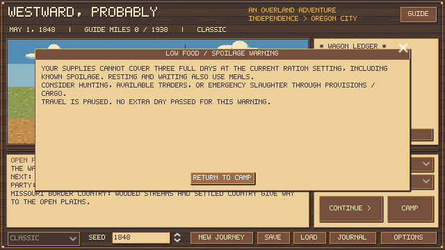
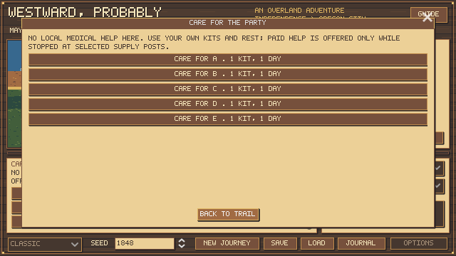

# Care access, defense and the recent-save review

October 22, 2026. These are game rules, not medical guidance or measured historical combat probabilities.

## Save findings

The inspected save is a completed April-departure banker journey: two of five travelers reached Oregon City on day 179. Its rule fingerprint predates the regional-trading update. The save and backup were only read, not overwritten or rewound. This report contains selected gameplay findings, not a copy of the player save.

| Day | Recorded state |
| ---: | --- |
| 124 | Fort Boise; 143 lb food before the crossing day |
| 132 | Powder River; 23 lb food |
| 133 | 8 lb food |
| 134 | Food reaches zero at Grande Ronde |
| 135–139 | Travel, delay and rest continue without food |
| 139 | Three travelers die; their records name lack of food as the cause |
| 140 | Emergency slaughter recovers 376 lb usable meat |
| 179 | Two arrive with 106 ration-lb food and $765.50 |

Five people on Filling require 15 lb/day. Rest and delays still consume food; they do not cure starvation. Measles and earlier exhaustion also occurred, but the three deaths were recorded as starvation. One hunting outing was recorded, and ammunition remained abundant. With two survivors, Filling demand fell to 6 lb/day; slaughter and preservation rebuilt their food supply.

This supports clearer warnings and more credible service access. One playthrough does not establish that every profession or the whole campaign is too easy. The new trader scarcity was not active in this save. Starvation damage has not been reduced on this evidence alone.

## Care access

Self-care kits remain usable on the road between events. Paid **local care** costs $20, one day and ordinary meals, and is offered only while actually stopped at Fort Laramie, Fort Bridger, Fort Hall or Fort Boise. Merely having passed a post does not provide remote treatment. The rule is enforced when choosing, including old paid-care offers; return to the trail and open a fresh menu if a migrated offer is disabled.

This shortlist is authored availability, not a claim that each post had a qualified resident physician in 1848. The interface calls it local care. Treatment effectiveness and recovery remain game estimates. The journey policy now considers care at stops instead of relying on paid help anywhere.

## Defense

Hostile defense begins with 25% injury risk; circling/guarding begins at 15%. The quoted risk is weighted when the encounter appears:

- Average living-party health below 70 multiplies the base by 1.25; below 40 by 1.6.
- Fewer than three living travelers with internal health at least 40 adds ten percentage points.
- Each previous clean hostile defense win subtracts two percentage points, capped at three wins. Friendly encounters, circling and wounded outcomes grant no defense victory.
- Positive risk floors remain: 15% for defense, 8% for circling; maximum risk is 75%. A healthy experienced five-person defense is 19%, not safe.

A defense injury causes 20 immediate health damage to one selected traveler and a severity-two wound. A weak defender may die immediately; an untreated serious wound can kill later. Circling causes 10 immediate damage and a severity-one wound on a successful injury roll, costs five bullets and one day, and can also kill a weak traveler. Defense costs ten bullets. The interface retains verbal health; internal values are documented here for tuning.

Friendly rider intentions remain hidden. Their quoted risk is conditional on hostility; friendly riders cause no hostile injury roll or combat experience, although chosen ammunition/time is spent. Named outcomes and a structured combat history survive saves. Existing pre-update pending choices remain compatible; newly presented encounters use these weighted rules. No combat minigame was added in this pass.

## Food warning

Automatic travel and the main Camp action pause when known food and spoilage cannot cover three full days at current rations. Zero food escalates to a separate starvation warning. The warning spends no day, supplies or random draw. Acknowledgement permits the next decision without repeatedly showing the same warning level; restarting/loading checks anew.

The forecast copies the meat ledger and follows the actual spoil-before-meals order. It assumes the current party/rations and does not predict future purchases, hunting, deaths or random losses. Landmark and service choices retain their declared time and meal costs. This safeguard prevents silent automatic travel into starvation; it does not remove the consequences of hunger.

## Historical scope

[BLM: Emigrant trails of southern Idaho](https://www.blm.gov/sites/default/files/documents/files/Library_Idaho_CulturalResourceSeries01.pdf) discusses variable physician access and care, including later emigrant/military evidence; it does not establish this service map for 1848. [NPS: Death and Danger on the Emigrant Trails](https://www.nps.gov/articles/000/death-on-trails.htm) provides broad hazard context, not these combat odds. Unidentified bandits and hostile riders are not assigned an ethnicity. Rates, injury effects, experience and service access are authored game tuning.

## Verification

The full regression suite passes, including 31 care/combat/warning checks: roadside restrictions, exact costs, serious wounds, delayed and immediate death, survivor counts, bounded experience, friendly outcomes, save compatibility, malformed data, forecasts and actual warning/care UI behavior. Native defense, food-warning and care screens were rendered and inspected.

Run `test.ps1`, `tests/combat_risk_study.gd`, and `tests/full_trail_balance.gd -- --oxen --label=care-defense` to reproduce the checks and experiments below. Earlier team/regional reports are archived snapshots of earlier rule signatures. Human playtesting remains necessary.

## Matched combat sample

400 seeds per cohort, identical fully fed five-person outfits and an actual hostile defense. Only health and previous victories differ. These are immediate outcomes; a separate regression verifies later untreated wound death.

| Internal health | Prior wins | Injury quote | Nonfatal injuries | Immediate deaths | Encounters |
| ---: | ---: | ---: | ---: | ---: | ---: |
| 85 | 0 | 25% | 102 | 0 | 400 |
| 85 | 3 | 19% | 79 | 0 | 400 |
| 30 | 0 | 50% | 210 | 0 | 400 |
| 30 | 3 | 44% | 184 | 0 | 400 |
| 15 | 0 | 50% | 0 | 210 | 400 |
| 15 | 3 | 44% | 0 | 184 | 400 |

## Full-journey sample

360 ordinary hunting/preservation/spare-ox journeys with restricted care. These policies normally avoid combat; the separate 2,400-encounter sample exercises fighting explicitly. Arrival means at least one survivor, not necessarily all five.

| Policy | Profession | Arrivals | All five arrive |
| --- | --- | ---: | ---: |
| hunting_preserve | farmer | 51/60 | 29 |
| hunting_preserve | carpenter | 60/60 | 60 |
| hunting_preserve | banker | 60/60 | 60 |
| spare_ox | farmer | 52/60 | 49 |
| spare_ox | carpenter | 60/60 | 60 |
| spare_ox | banker | 60/60 | 60 |

Both experiments have zero simulation invariant errors.

[Combat sample](combat-risk-study.json) / [Journey sample](care-defense-oxen.json)

