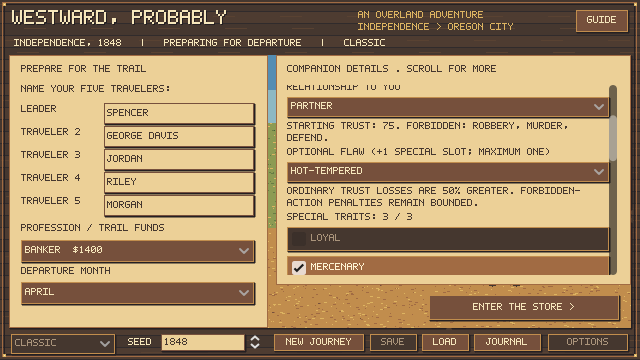

# Expanded character catalog

October 22, 2026. The editor now offers eight temperaments, eight value systems, sixteen specials, twelve flaws and thirteen relationships to the leader, alongside the four existing backgrounds. All of these shipped options have current rules; none is a locked promise of a future feature.

Choose one temperament, one value system, one background and one relationship. A companion may start with zero, one or two specials, or up to three with exactly one optional flaw. The leader remains player-defined. There are 28,291,328 legal combinations before names and wage offers: 8 × 8 × 4 × 13 × (137 selections without a flaw + 12 × 697 selections with a flaw). These combinations are not claimed to have equal value or to have each been playtested.

Catalog definitions live in `data/character_catalog.json`; `simulation/character_catalog.gd` validates and evaluates their effects. The first four specials, first two flaws and original temperament/value/relationship identifiers remain compatible with earlier saves. Existing saved characters are not stripped of specials to meet the new creation cap.

## Temperaments

| Choice | Current effect |
| --- | --- |
| Cautious | Objects to armed defense and pushing sick travelers at a grueling pace. |
| Bold | Gains trust when willing to stand and defend the party. |
| Steady | Ordinary trust losses are reduced by 25%; neither admires nor resents armed defense. |
| Nervous | Ordinary trust losses are 25% greater; strongly resents armed defense and pushing the sick. |
| Reckless | Strongly approves of a willing armed defense; does not object merely because a sick party travels hard. |
| Patient | Ordinary trust losses are reduced by 25%; mildly resents armed defense. |
| Stubborn | Ordinary disagreements hurt trust 25% more; mildly resents armed defense. |
| Adaptable | Accepts armed defense neutrally and gains a little trust when the party rests for someone sick. |

## Values and boundaries

| Choice | Current effect |
| --- | --- |
| Compassionate | Values care and rest for sick travelers; forbids robbery, murder and cannibalism. |
| Pragmatic | Accepts practical compromises but forbids murder. Expects a small wage premium. |
| Principled | Values keeping obligations; forbids robbery, murder, cannibalism and unpaid wages. |
| Self-serving | Accepts theft but forbids murder; appreciates personal care, without gaining trust from care for others. |
| Ruthless | Approves of robbery and has no default forbidden crime. Still reacts to unpaid personal wages and low trust. |
| Communal | Values care for others and resting for the sick; forbids robbery, murder and cannibalism. |
| Pacifist | Values care; refuses armed defense, robbery and murder. Accepting human remains is a separate boundary. |
| Opportunistic | Approves of robbery but forbids murder; values practical success more than helping strangers. |

## Specials

| Choice | Current effect |
| --- | --- |
| Loyal | Sticks with you: will not leave or refuse to help until trust falls 10 points lower than usual, and never betrays the party. Trust losses are normal. +10 cents/day if hired. |
| Mercenary | Requires an agreed cash wage plus party food. Honored payments can build trust. |
| Veteran | A fit, willing companion reduces confrontation injury risk by 3 percentage points, subject to its floor. |
| Cannibal | Has no personal objection to eating human remains. Does not grant approval of murder or deception. |
| Hardy | Personal health losses from all causes are reduced by 20%, rounded up; +10 cents/day if hired. |
| Quick Healer | Personal positive health gains increase by 50%, rounded down; +10 cents/day if hired. Recovery timers unchanged. |
| Iron Stomach | Personal health losses from food shortage are reduced by 25%; +5 cents/day if hired. |
| Sure-footed | Personal river-crossing injury damage is reduced by 25%; +5 cents/day if hired. |
| Cool-headed | Personal confrontation injury damage is reduced by 25%; +10 cents/day if hired. |
| Weatherwise | Personal exposure damage is reduced by 25%; does not replace warm clothing. +5 cents/day if hired. |
| Tireless | Personal exhaustion damage is reduced by 25%; +10 cents/day if hired. |
| Stoic | Takes hardship in stride: trust lost to rest days, pushing the sick, stopping for the sick and armed defense is halved. Moral choices and wages count in full. +5 cents/day if hired. |
| Field Medic | Provides the existing Caregiving party benefit even with another background; does not stack. +15 cents/day if hired. |
| Wagonwright | Provides the existing Carpentry party benefit even with another background; does not stack. +15 cents/day if hired. |
| Sharpshooter | Provides the existing Hunting reload benefit even with another background; does not stack. +15 cents/day if hired. |
| Haggler | Provides the existing Trading purchase discount even with another background; does not stack. +10 cents/day if hired. |

## Optional flaws

| Choice | Current effect |
| --- | --- |
| Frail | Takes 25% more health damage from all causes, rounded up. |
| Slow Healer | Health gains are halved, rounded down (minimum 1). Illness recovery timers are unchanged. |
| Sickly | Takes 50% more daily damage from an active illness; injuries and recovery timers are unchanged. |
| Cold-sensitive | Takes 50% more exposure damage when inadequately clothed. |
| Delicate Stomach | Takes 50% more health damage from food shortage. |
| Poor Endurance | Takes 50% more exhaustion damage from hard travel. |
| Clumsy | Takes 50% more personal injury damage from river crossings. |
| Shaken by Gunfire | Takes 50% more damage when personally injured in an armed confrontation. |
| Hot-tempered | Ordinary trust losses are 50% greater. Forbidden-action penalties remain bounded. |
| Distrustful | Trust gains are halved, rounded to half points. |
| Proud | Gains no trust from arranging care for them personally; can still appreciate care for others according to values. |
| Restless | Loses 1 trust on each rest day, including rest taken for illness. This can coexist with approval of caring for the sick. |

## Relationships to the leader

| Relationship | Starting trust | Departure/betrayal warning threshold reduction | Meaning |
| --- | ---: | ---: | --- |
| Fellow traveler | 50 | 0 | A fellow traveler with no special prior attachment. |
| Friend | 60 | 5 | Established friendship; stronger attachment to the leader. |
| Family | 70 | 10 | A close relative; greater attachment is not permission to cross their boundaries. |
| Stranger | 40 | 0 | An unfamiliar traveler; trust starts lower. |
| Acquaintance | 45 | 0 | Someone you know slightly. |
| Partner | 75 | 12 | A spouse or partner with strong trust and commitment. |
| Sibling | 70 | 10 | A brother or sister with strong prior attachment. |
| Cousin | 60 | 5 | A relative with some prior familiarity and attachment. |
| Parent | 75 | 12 | An adult companion who is the leader's parent. |
| Adult child | 75 | 12 | An adult companion who is the leader's child. |
| Mentor | 60 | 5 | An experienced acquaintance who knows you well. |
| Former employer | 45 | 0 | Someone from a former working relationship; this does not itself create a wage contract. |
| Rival | 30 | 0 | An existing rival; starts with little trust, but may come to respect your decisions. |

Attachment lowers existing breaking/betrayal-warning thresholds; it does not erase boundaries or grant consent to violence. Wages remain a separate Mercenary agreement, so family, friends and strangers can be hired or unpaid. These are relationships to the leader; a web of ties between other party members is not yet implemented. Betrayal capability remains a descriptive framework flag, not an implemented retaliation event.

## How effects combine

Personal health multipliers apply only to that living, active companion. Negative health losses round up in magnitude and never become zero. Positive gains round down with a minimum gain of one. Context-specific effects combine with general effects. Sickly affects the daily damage from illnesses, not injuries or the chance of contracting disease; no new diagnosis or illness model is implied. None of the health specials changes condition recovery timers.

Trust factors affect ordinary gains/losses and round to the existing half-point precision, with memories bounded to the supported −12/+2 range. Forbidden-action penalties bypass reductions from Stoic and temperament. Since October 23, 2026 (Spencer): Stoic halves only hardship losses (rest days, resting or pushing with the sick, armed defense); Loyal no longer softens losses but lowers the breaking point by 10 and never betrays. A Restless rest-day objection can coexist with approval of resting for a sick traveler; both are explicit memories. Proud changes the trust reward for personal care, not whether medical treatment works.

Field Medic, Wagonwright, Sharpshooter and Haggler let someone supply one of the existing background benefits with a different primary background. They require the same fit, living, willing helper as the original background; duplicate sources do not stack. Personal resilience and trust modifiers are not helper skills and stay active while the individual is alive and traveling with the party.

New special wage premiums appear in the existing pure wage quote and apply only when entering a paid agreement. Original wage rules remain in party_benefits.json. Precise premiums and effects are authored game tuning, not newly documented historical wages. A costlier build does not rewrite an existing contract.

## Creation and future replacement companions

The preparation editor exposes the full catalog, displays the starting trust and effective forbidden actions, explains flaws visibly, and provides tooltips for personalities, relationships and specials. Cannibal removes that individual's cannibalism objection from the summary without hiding an independent murder boundary. A Generate a Companion button replaces only the selected draft companion, including their displayed name and acceptable wage offer. Long generated names use a surname initial to fit the existing naming field. Generated names follow the traveler's generated outfit (dress and bonnet draws women's given names) and heritage (Irish, Scottish, German, French Canadian, Mexican and African American pools; surname from the pool, given name usually from it, sometimes Americanized). Mixed heritage combines two pools; other labels use the general 1840s American pool. Editing outfit or heritage afterward does not rename anyone. New Journey resets the generation counter and drafts.

`PartyCharacter.generate_candidate(seed, candidate_index, relationship="stranger")` returns a detached offer containing candidate_id, full name, a profile and optional weekly terms. It uses its own random stream and does not touch active party members, money, time or any journey RNG. The same seed/index/relationship gives the same offer. Use an explicit relationship for an appropriate recruit; "random" samples all thirteen relationships for creation. The returned profile uses a placeholder companion id of 1, which a future recruitment transaction must assign to its destination identity.

Candidates are adults without an age simulation. Generated Ruthless/Opportunistic candidates may carry the existing betrayal-capability flag; that flag does not execute betrayal. The generator is reusable groundwork: no settlement recruitment button, replacement-slot transaction, companion-to-companion bonds, crime encounter, murder attempt, corpse inventory, consumption action, witness system or trait acquisition is added by this pass.

## Validation

The dedicated catalog suite has 576 passing checks. It validates catalog errors atomically, reproduces and validates 256 seeded candidates covering every special and flaw, checks non-mutation of an active journey, relationship thresholds, personal health contexts, trust changes, helper eligibility, an authentic prior-catalog save, actual creation controls and expanded-profile save/load. All existing regression suites also pass. The native editor capture was rendered and visually inspected.

A separate twelve-journey integration sample (`generated-party-journeys.json`) used generated rosters, real wages, ordinary disease/weather, the existing cautious hunting/preservation policy, and public actions for the full route. All twelve arrived in 178–221 days; 59 of 60 travelers survived, with no departures and zero selected state/setup/save errors. Saves were checked every fifty actions and at finish. Banker funds and the small seed sample make this a smoke test, not evidence that all builds are balanced or that those survival figures describe history.

Reproduce with project-local APPDATA as in test.ps1, then run the bundled Godot console with `--headless --path . --script tests/test_character_catalog.gd` or `--headless --path . --script tests/generated_party_journeys.gd`. The latter report deliberately uses a new filename; previous economy and specialist reports remain archived.

