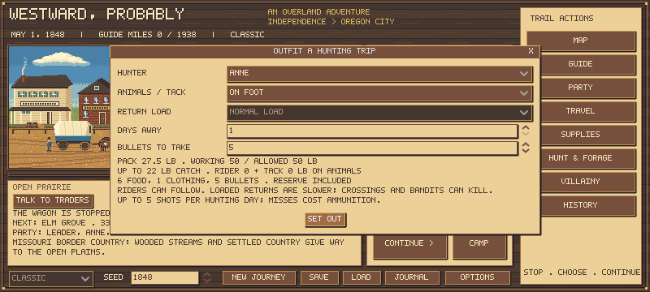

# Companion hunting follow-up shots

Companions now get up to the leader's configured five shots during each hunting day, bounded by their packed ammunition and actual carrying room. They can shoot again after a miss while the animal remains in sight. A successful animal is removed; it cannot be harvested twice. No extra day or extra daily meal is charged per shot.

An independent local instance of the existing leader hunting model supplies the same empty-day chance, weighted species and one-to-three animals. The existing return-search fraction removes opportunities on the final return day; earlier days remain unaffected. It does not manufacture a new animal for every bullet. Existing companion hit/skill/season modifiers remain. A miss has an authored 35% escape chance; otherwise another shot at the animal is possible within the daily budget. These are game abstractions, not measured historical rates.

Empty encounters or time-limited searches use no bullets. Actual hits and misses cost one each. The hunter stops at the daily cap, exhausted ammunition, no visible animals, or less than 2 lb usable room. Existing physical meat conversion, meals, spoilage, health, encounters, return time and stock wear remain. Returns and the journal report actual animals, shots and hauled meat. The outfitting screen explains the daily shot ceiling.

The private encounter plan is deterministic and does not change leader/trip RNG when previewed. Shots continue to consume the saved private stream during actual hunting. No new persistent schema is needed. A genuine active three-day save from rules 3b9a07...34fc6 is whitelisted using the existing compatible-save mechanism; its ammunition, trip and RNG survive loading unchanged. New decisions begin on subsequent days.

Focused tests cover a miss followed by a hit, daily resets, depleted ammo, escaped and killed targets, empty searches, cargo limits, exact mixed-batch audit mass and genuine old-save preservation. The earlier return-time test now checks retained encounter opportunities and bounded shot costs, rather than assuming exactly one bullet on every day.

Re-run the frozen mobile-camp matrix on new development/held-out seeds 165000-165003 and 175000-175003, same unchanged serial/parallel/mobile strategies and shared equipment, to measure the combined survival and ammo consequences. Keep previous sources/cohorts separate. Full tests and 24 store + 20 current-policy outlaw integrations are required. No food prices, starting cash, health/carrying curves or bot strategy are changed to make this rule win.

## Frozen comparison

Runtime/test checkpoint **cd4bc77** completed 144 journeys (72 development, 72 fresh validation), plus 48 matched mobile-strategy controls from old game 0278205. Same starting carts, costs and policy source files were verified. Existing game/data are identical outside the intended field-hunt/escape rules and compatible-save whitelist. The rule bundle also changes encounter generation to the finite leader encounter model, so the result cannot be attributed solely to allowing a second trigger pull.

| Phase / profession | Old arrivals | New arrivals | Old returned catch food | New returned catch food | Old shots | New shots |
|---|---:|---:|---:|---:|---:|---:|
| development / farmer | 1/8 | 1/8 | 103 | 270 | 32 | 59 |
| development / carpenter | 7/8 | 7/8 | 23 | 363 | 12 | 50 |
| development / banker | 8/8 | 8/8 | 86 | 289 | 30 | 48 |
| validation / farmer | 0/8 | 0/8 | 44 | 299 | 21 | 72 |
| validation / carpenter | 5/8 | 6/8 | 22 | 187 | 11 | 25 |
| validation / banker | 7/8 | 7/8 | 88 | 111 | 12 | 20 |

Catch entries are actual delivered food units, not physical pounds or guaranteed yield per dispatch. Changed journeys may dispatch different numbers of trips and lose different people/animals. They are totals across failed and successful runs, not per-trip efficacy estimates.

The one shared farmer development arrival finished 17 days sooner. There were no farmer arrivals in either validation version, so there is no held-out completed-route farmer time estimate. Carpenter validation gained one arrival without losing an old arrival; several other matched journeys were unchanged or slower. The small reused-world sample does not certify farmer balance. Food delivery improves while ammo, actual carrying, private meals, spoilage, illness, delayed returns and stock losses remain constraints.

## Verification and evidence

All **72 suites**, including **122 focused repeat-shot checks**, passed. The final checkpoint also passed **24 store and 20 current-policy outlaw journeys**, zero errors; these are independent integration evidence rather than extra balance worlds. The first full run exposed two old one-bullet assertions; those now reconcile actual journal shot counts with inventory and combat costs. The old-control run initially lacked an output directory; that failed write was excluded and the controls were rerun successfully. Preliminary results are separate.

[New-version compact evidence](repeat-hunt-summary-01.json) records source/rule fingerprints and input digests. [Matched old/new comparison](repeat-hunt-control-01.json) records paired arrivals/time differences and hashes of all ten archived reports. Final parent archives are .tools/hunting-repeat-{development,validation}-{serial,parallel,mobile}-02.json and hunting-repeat-control-{development,validation}-02.json; every copy was SHA-256 checked. Integration archives are .tools/repeat-store-journeys-02.json and repeat-current-outlaw-journeys-02.json. Full test log: .tools/repeat-final-tests-02.log. The earlier -01 reports are preliminary; never pool them into the final sample.

