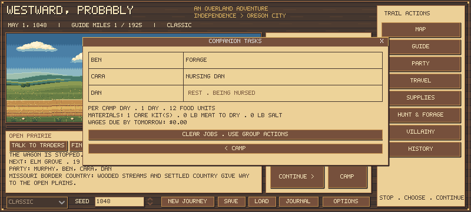

# Coordinated camp-work results

Frozen game/test checkpoint: **45f124c**. The same source completed **864 journeys: 432 development + 432 held-out**, with zero campaign errors. All **70 Godot suites**, including 257 coordinated-work checks, and **24 store + 20 current-policy outlaw integration journeys** passed. This measures a declared public-action strategy; it does not certify historical accuracy or optimal play.

## Corrections

Camp roles now follow the first active traveler when the original leader dies. The acting leader cannot also be a companion chore worker, helper or separately dispatched hunter. Their forage action works; another activity ends their nursing. Actual selected hunters work that day, including weak willing helpers whose standing job otherwise falls back to Rest. Neither receives extra rest recovery for hunting. Hauling, recovery, prices, funds, yields and weather data are unchanged; no new save schema is stored.

The test runner adds real support assignments and observation, not automatic jobs in the player game. Nursing consumes actual kits; preservation consumes salt/time/meat. Patients rest and workers cannot also be hunting helpers. Quote/replay tests verify that observation does not change inventory, saves or random streams.

## Matched comparison

Each phase crosses three professions, May/July departures, four hunting strategies, three camp policies and six seeds. Each cell uses steady pace, standard six-ox/1,700-food supplies, practical equipment costs and 65% scripted aim. The same seeds are reused across strategies: these are not 864 independent worlds. Development uses 125000-125005; validation uses separate 135000-135005. Older studies and pilots are excluded.

- **Off:** preceding survival priorities without deliberate support chores.
- **Support:** real nursing/foraging/drying assignments, with those workers unavailable to help hunt.
- **Coordinated:** support plus bounded leader-care rests, morning preservation days and emergency companion dispatch. This is a bundle of changes, not an isolated estimate of chores.

See [the protocol](COORDINATED_CAMP_PROTOCOL.md). Up to two foragers address scarce produce; care needs a real kit. New hunt meat is not credited as an already completed morning drying batch. Distant rescue is not automated.

## Arrivals

Each entry is arrivals / 48 journeys across both departure months and four hunting methods.

| Phase | Profession | Off | Support | Coordinated |
|---|---|---:|---:|---:|
| development | farmer | 9/48 | 8/48 | 7/48 |
| development | carpenter | 38/48 | 36/48 | 34/48 |
| development | banker | 48/48 | 46/48 | 44/48 |
| validation | farmer | 2/48 | 6/48 | 4/48 |
| validation | carpenter | 40/48 | 40/48 | 36/48 |
| validation | banker | 44/48 | 47/48 | 48/48 |

Held-out arrivals with all five originals present were farmer **2 / 0 / 0**, carpenter **28 / 31 / 29**, banker **41 / 46 / 43** for Off / Support / Coordinated. Reaching Oregon with survivors differs from keeping the starting party intact.

The farmer improvement does not replicate consistently across phases. Held-out support had five matched new arrivals, lost one Off arrival, and shared one arriving pair with Off. That shared pair took **78 more days** with support. Coordinated had four new arrivals and lost both Off arrivals, with **no common arriving farmer pairs**; its medians cannot establish a speed gain.

Support swapped six carpenter gains for six losses in validation; coordinated reduced carpenter arrivals by four. Bankers improved in validation, while development showed the opposite direction. Lost helping capacity and elapsed seasonal time matter alongside task benefits.

## Actual work and costs

Totals below cover all 144 held-out journeys per policy, including failures. Processed/retained amounts are food units, not physical pounds. Shared forage includes the leader on explicit forage days; it is not credited solely to companions.

| Policy | Visits / care kits | Drying batches | Processed / retained food units | Salt lb | Shared forage lb |
|---|---:|---:|---:|---:|---:|
| off | 0 / 0 | 0 | 0 / 0 | 0 | 43.0 |
| support | 18 / 18 | 34 | 1633 / 1350 | 45 | 5985.0 |
| coordinated | 40 / 40 | 538 | 24688 / 20974 | 1285 | 5906.0 |

More processing is not necessarily worthwhile: coordinated camp days spend time and salt that could go to travel or hunting. Support drying can be rare because leader priorities already consume/process the surplus. The next policy should consider actual impending spoilage and travel urgency.

Held-out farmer mean hungry days were Off **33.46**, Support **29.92**, Coordinated **27.83**. Lower cumulative illness/hunger does not prove healthier survival: journey duration, deaths, number present and season differ. The compact evidence records duration, hunger rates, scurvy exposure, materials and matched outcomes. These are not clinical effect estimates.

## Strategy flexibility and remaining work

Each policy has 12 farmer runs using each of legacy group hunts, explicit foot groups, solo led-horse returns and companion outriders. In held-out Off/outrider runs, 86 actual dispatches occurred across 12 journeys. Support/coordinated jobs are reassigned as health, produce and surplus change. Normal decisions also adjust rations, buy affordable supplies, preserve food and slaughter spare oxen while protecting four working animals. Coordinated can dispatch emergency hunters even in other method groups.

However, the broad hunting strategy stays fixed. These scripts do not decide midjourney to invest in an outrider, replace a lost horse, switch to a better animal/tack arrangement or redesign the outfit. Mounted methods fall back to foot hunts; they do not automatically replenish a lost horse. Emergency delegation is late by design and does not establish the value of preventive mounted support. This is a substantial limitation for judging farmer viability, not evidence that adaptive player strategies cannot work.

Farmer balance remains open. Next inspect nutrition/death timelines and test adaptive investment, replacement and hunting-method choices under actual budgets before attributing poor outcomes to starting cash. Make preservation decisions against real spoilage and season. Validate any revised policy on fresh seeds rather than silently reusing these held-out worlds. Human aiming, pacing and judgement remain untested. One-year caps remain reported outcomes, not hidden software errors.

## Reproduction and evidence

Run ./test.ps1. Run tests/coordinated_camp_campaign.gd with --camp-work=off|support|coordinated, --professions=farmer,carpenter,banker --months=5,7 --methods=legacy,foot,lead,outrider --equipment=practical --pace=1 --outfit=standard --seeds=6 and the phase seed start above. Use a new --label each time; archives refuse overwrite.

The six full archives are preserved under parent .tools/hunting-camp-{development,validation}-{off,support,coordinated}-01.json; copies were SHA-256 checked against the frozen checkout. tests/summarize_camp_work.py checks source/rule/settings compatibility, completeness and matching, rejecting duplicate or missing-policy rows. [Committed compact evidence](coordinated-camp-summary-01.json) retains input digests, source fingerprints and grouped outcomes.

Logs: .tools/camp-final-tests.log, camp-{development,validation}-*.log, camp-store.log, camp-outlaw.log. Integration reports: .tools/camp-store-journeys.json and .tools/camp-current-outlaw-journeys.json, with verified digests in camp-integration-preservation.json. Player saves and the three preexisting farmer debug pilots were preserved.
