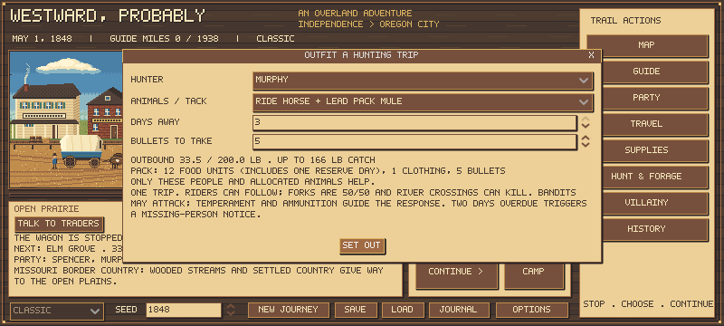
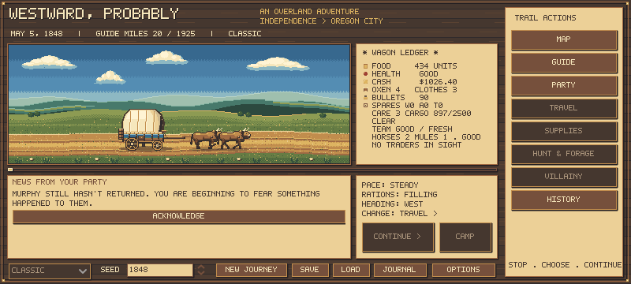

# Hunting trips and mounted outriders

Open **Camp > Field trips > Outfit a hunting trip**, the companion's task menu, or the normal Hunt command. Choose the leader to play the hunting minigame or a companion to send away. Foot trips take one day; riding trips take one to three. A led pack animal increases cargo but does not turn a walker into a rider. Scouts and new Soldier/Criminal backgrounds remain future work.

## Actual people, packs and animals

Leader and companion hunts share one outfit calculation. Only the selected people and allocated horse/mule/tack add capacity. Good and Fair health retain full human capacity; Poor and Very Poor reduce it along the shared walking/hauling curve. Broken legs prevent human hauling. Rations for the chosen duration plus one reserve day, one clothing set and personal gear per person, and selected ammunition consume outbound capacity. Catch fits in the remaining room, within the existing 200 lb retrieval ceiling. The screen quotes these amounts before departure. Merely owning animals grants no outing cargo. Riding needs a saddle and bags; packing needs a pack saddle.

The actual food batches keep their weight, nutrients and expiry. Food, clothing, bullets, animals and tack leave the camp stores. Empty returns still consume meals and ammunition. Personal supplies and unused ammunition return once; catch is limited again by the receiving party's actual storage. Workload, country, season and weather affect animal wear through the shared mount formula. These are game rules, not a claim that every lone hunter historically hauled this amount.

The leader's explicit outfit uses the same rules, while the minigame remains interactive. Camp helpers must be explicitly selected, and in assignment mode must have Help leader hunt assigned. Other camp work can share that day. The older no-argument simulation hunting API retains group behavior for existing scripts; new UI hunts always supply an explicit outfit. Existing journey bots therefore do not yet measure the new outing economy.

## Away and returning

Each dispatched companion has their own saved supplies, health and random stream. They keep their roster slot but cannot simultaneously work in camp, haul for the party, defend it, lend passive specialist benefits or receive wages remotely. Living paid hunters accrue wages; eligible automatic payments resume after rejoining.

A mounted hunter can rejoin a moving party within riding distance. Returning east toward a hunter permits reunion. A fork gives a saved, one-time 50/50 chance of following the wagon branch; a wrong-turn hunter waits at the fork. Rivers require a separate crossing day through the actual river engine, spending real meals and supplies and risking injuries and lost animals. A lone hunter also faces an authored fatal-drowning chance after a crossing mishap. This is not a measured historical probability. Riders currently use their animal crossing rather than a ferry; no ferry purse is packed. A possible injury/mishap delays the return by one or two days. Hunting success and delays are authored tuning in data/field_outings.json, not measured historical probabilities.

Travel warns before leaving foot hunters or overdue riders. Crossings, forks and flight also warn about riding hunters. Turning back toward them is allowed without treating the turn itself as abandonment. Back restores the previous choices; Leave records consent and restores the original action so it can be taken. Ordinary warnings offer a one-day wait. Flight warnings offer only Leave/Back, avoiding a free safe rest during combat.

If the party has moved beyond a possible reunion, the hunter can be stranded at a camp, river or fork along the return route. The map marks this camp separately from a wagon cache. **Camp > Field trips > Look for hunters at this camp** recovers them at that location. Their food can spoil or run out; illness, exposure, death or departure can follow. Survival hunting uses the same physical outfit allowance. A nearby mounted hunter may catch up on a safe continuous road depending on trust and temperament. Departing hunters take their allocated animals/tack. Two days after the original expected return date, an unreturned traveler triggers one uncertain missing-person notification. The roster shows AWAY or MISSING and the original outfit, never the hidden death or lost horse. The party learns the actual offscreen fate, health and supplies when it finds the hunter.

Trip settings persist as preferences; trips do not automatically repeat. Standing camp chores remain unchanged.

## Persistence and verification

Character schema 5 strictly validates trip identity, route position, supplies, stock, timing and reserved party entries. A genuine schema-4 fixture from master 2e01155 verifies migration without changing inventory or the original random stream. The prior rules signatures are whitelisted. A genuine immediately preceding schema-5 fixture with an active mounted trip also preserves its actual reserved supplies, animals, return date and random streams after the carrying-curve change. Active trips, stranded camps, departure warnings and authoritative crime escape menus round-trip through JSON.

Focused checks cover shared carrying, reservations, meals and ammunition, wage settlement, travel and river timing, delayed returns, recovery, death, migration, rejected malformed saves, and actual UI dispatch. Native Godot screens were inspected. Full-suite and journey evidence is recorded in CLAUDE_HANDOFF.md after validation.

A new route-balance study using actual assignments and outfitted trips is still needed; these software checks do not certify farmer viability, hunting yields or total journey balance.

## Carrying audit and revised health breakpoints

Spencer reported a solo hunt limited to 10 lb at Fair health. The previous calculation reproduced it exactly at health 75: 50 x 0.75 = 37.5 lb gross, less 15 lb personal gear, 6 lb clothing, 6 lb food and 0.5 lb ammunition = 10 lb catch. At health 60 it left only 2 lb. There was no fixed 10 lb cap. This identified a health-label mismatch, not missing animal cargo.

Spencer chose full capacity through Good **and Fair**, with reductions beginning in Poor. One data-driven continuous curve now serves walking, outfitting, leader/delegated/guard hunting and loot hauling. It replaces the separate walking relief multiplier.

| Health score | Displayed condition | Human allowance |
| --- | --- | --- |
| 50-100 | Fair / Good | 100% |
| 20-49 | Poor | 50% at 20, smoothly rising to 100% at 50 |
| 1-19 | Very Poor | Smoothly rises from zero to 50% at 20 |
| 0 or dead/absent | Unavailable | Zero |
| Any score with broken leg | Injury restriction | Zero human hauling |

Base limits remain 50 lb per walker (40 before November 2026) and 50 lb per retrieval participant, with the existing 200 lb group retrieval ceiling. Pack mass is still subtracted once. Thus the quoted solo foot hunter with a 27.5 lb pack has 22 lb catch room throughout Good/Fair. A Poor hunter at health 35 has 37.5 lb gross and 10 lb catch room. This is one-trip capacity, not total usable meat on the carcass.

These health breakpoints are explicit gameplay interpretation, not clinical measurements of strength. [Army load-carriage research](https://www.army.mil/article/234235/) supports treating load, terrain, fatigue and speed as interacting costs; it does not justify interpreting an abstract health score as a literal lifting-strength percentage. A revised day-hunt kit or multiple retrieval trips would be separate changes. The present change does not invent extra hauling or remove the actual pack costs.

## Horse cargo revision

The requested rider/tack/cargo budgets, strenuous loads and ride-out/lead-home modes are now implemented. See [horse loads and wagon hunts](HORSE_LOADS.md) for current limits, physical accounting, evidence and limitations. The earlier 25 lb saddlebag allowance is no longer treated as the anatomical carrying limit. Good/Fair human carrying remains unchanged.

## Isolated bandit encounters

Hunters and mounted outriders have an authored 2.5% daily chance of encountering bandits, initially capped at one encounter per trip. This is gameplay tuning, not a measured 1848 crime rate. The existing bandit-demand and combat model runs with only the actual traveler, their own health/background, outfit, ammunition and animals. Goods demanded are capped by what they really carry. The isolated bandit pool includes horses and mules; the ordinary wagon encounter pool is unchanged.

An armed Bold/Reckless traveler or Veteran who is willing to defend can fight if carrying the ten bullets required by the existing event. Others generally surrender; a capable rider may flee a severe demand, while Cautious/Nervous travelers prefer yielding. Escape spends the existing one day and animal strain; the lone traveler can be caught and wounded, using the mounted flight model. A lone gunshot victim also has an authored fatal-on-hit risk. Surrender and defense do not invent an extra day: their immediate consequences happen before the normal field day. A full-day escape replaces that day's hunting and meals, then delays the return.

Victories, wounds, stolen supplies or mounts and deaths are saved privately. The wagon learns the encounter on reunion or discovery; an unreturned traveler uses the same two-day uncertain missing notice. Dead travelers and stolen horses cannot return. Personal offscreen victories do not help the wagon's combat history until learned on return.

## Detention research before adding captured companions

Spencer proposed short custody with an opportunity to intervene, then questioned whether prisons fit the 1848 frontier. **Companion arrest, custody, trial and prison-break events are not implemented in this checkpoint.** Prison breaks remain outside this pass. Actual personal participation, identification and the spread of news should gate any later legal interception; a future Criminal background alone is not proof of a crime.

[Missouri State Archives](https://www.sos.mo.gov/archives/history/timeline/2) dates the first Missouri penitentiary admission to March 8, 1836. [Oregon State Archives](https://sos.oregon.gov/archives/provisional-guide/pages/penitentiary.aspx) distinguishes the 1845 Oregon City jail, its 1846 fire, rudimentary county detention and the territorial penitentiary opened in 1856 (the 1851 commission was not an operating prison). [NPS](https://www.nps.gov/cali/planyourvisit/fort-laramie.htm) dates the Army purchase of Fort Laramie to 1849; [Fort Bridger's NPS history](https://www.nps.gov/mopi/planyourvisit/fort-bridger.htm) likewise places its military phase after 1848. These dates expose a necessary audit of the current wanted-system assumptions. Do not add military guardhouses/courts to every 1848 trading post.

[BLM's Oregon Trail education guide](https://www.blm.gov/sites/default/files/learn_interp_nhotic_edguide.pdf) describes emigrant companies administering their own justice. Temporary guarded detention or an emigrant hearing may fit a trail encounter, while formal custody needs a verified locality, date and authority. The absence of a US sheriff at a location does not mean there were no Indigenous laws or other jurisdictions. Next legal work should establish those distinctions before new custody mechanics.

Spencer narrowed the proposed formal-prison mechanic to verified Missouri jurisdiction in the 1848 game, with transfer to an actual penitentiary rather than a prison at every stop. Temporary custody is distinct from a sentence of imprisonment; a lockup building alone does not establish local sentencing practice. This remains a proposed gameplay boundary pending the date/jurisdiction audit. Finish this outing slice before expanding detention or prison breaks.

## Validated checkpoint

Simulation/UI checkpoint c314dc1 passed all 66 suites, including 257 field-outing checks, 89 shared-camp-work checks and 46 repair/guard checks. A clean isolated checkout also passed 24 store and 20 current-policy outlaw journeys with zero reported errors. Those policies still use legacy group hunts; they validate integration and saves, not the balance of dispatched or explicitly outfitted hunting.

The archived outlaw actor exposed one scurvy/rest loop after the carrying change: it never sought produce. Its failed evidence remains separate. tests/current_outlaw_journeys.gd runs the same twenty crime scenarios with the already-existing current counter/produce/foraging policy; no game-health changes were made to accommodate the old actor. Native outfitting, missing-person notice, party/trip presentation and map marker were reviewed. Earlier failed and interrupted development logs are separate from the final passing evidence.

## Follow-up shots

Companions can now shoot again after a miss while game remains visible, up to the leader-configured five shots per day and their actual ammunition. A miss can scare the animal away; empty searches spend no bullets. The shared finite encounter model and return-search fraction limit available animals. Every successful animal is removed and real pack/cargo room bounds recovery. See [follow-up shots and evidence](COMPANION_REPEAT_SHOTS.md).
