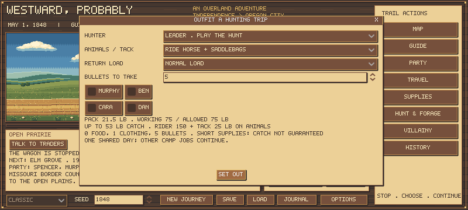

# Hunting and survival balance: first pass

The pass fixed a deterministic rejection that stopped hungry parties from hunting. It **does not declare overall survival balance settled**: farmers remain fragile in these scripts, and leader hunts still lack a time cost for leading a heavy catch home.

## Scope and evidence

Source checkpoint **44d0eae** completed **1,428 final-source journeys** with zero state, save, policy-stall or source-change errors: 1,008 primary journeys, 336 stockpiling sensitivities and 84 aiming sensitivities. Of these, 756 used development seeds and 672 used separate held-out seeds. Death and a test-only 365-day cap remain recorded outcomes, not software errors. Small diagnostic pilots are excluded.

All **68 Godot suites**, plus **24 store and 20 current-policy outlaw journeys**, passed from the same isolated source checkpoint. The new instrumentation/emergency suite has 461 checks and compares saved state/RNG with the unmodified engine. Native Godot short-provisions outfitting was inspected.

See [protocol](HUNTING_BALANCE_PROTOCOL.md) and [compact archive](hunting-balance-summary-01.json). Full reports were preserved in ignored .tools with matching SHA256 digests. Each archive records source/rule fingerprints and the actual outfits. No historical prices, starting funds, food conversion, carrying limits, hunting yields, weather or wagon-noise rate were retuned.

## Corrected starvation trap

A real farmer pilot reached day 32 with seven food units, four travelers and forty bullets. The explicit day hunt was forbidden because its pack needed outing food plus a reserve day. The party could become too hungry to obtain food.

Same-day outings now pack only available food/clothing and show **SHORT SUPPLIES: catch not guaranteed**. They still need actual ammunition. An unsuccessful hunt costs a hungry day; a successful leader hunt supplies that day's actual meal before packing the remainder. Longer expeditions retain their full supplies/reserve requirement. Quotes, reservations, stock return and saves use actual quantities.

## Held-out results

These are scripted strategies, not optimal human play. Each cell below is **12 journeys**: six matched seeds, May and July departures. Practical outfits buy a $58 horse/saddle/bags only for mounted and outrider methods. The parallel shared-equipment cohort gives every method that same equipment and cash cost.

The policy uses cautious pace (0), a short health-rest rule, public resupply/produce/foraging, salted preservation and four working oxen protected from elective slaughter. It seeks two current meals before hunting; outriders are provisioned/dispatched earlier. It accepts leaving away hunters at dangerous boundaries and never rescues a distant camp automatically. See protocol for fallbacks. Different choices change later random draws; repeated seeds across cohorts are not independent worlds.

| Method | Farmer arrivals | Carpenter arrivals | Banker arrivals |
| --- | ---: | ---: | ---: |
| Legacy group | 2/12 | 10/12 | 12/12 |
| Outfitted foot group | 1/12 | 10/12 | 12/12 |
| Ride home | 3/12 | 9/12 | 12/12 |
| Heavy riding return | 2/12 | 11/12 | 12/12 |
| Lead horse home | 5/12 | 10/12 | 12/12 |
| Bring wagon | 1/12 | 10/12 | 12/12 |
| Companion outrider | 1/12 | 11/12 | 12/12 |

**No practical-outfit farmer strategy reunited all five original travelers in a held-out arrival.** For farmers, led returns arrived in 3/6 May and 2/6 July starts. Legacy group hunting arrived in 2/6 May and 0/6 July starts. This is a warning about current survival/policy interaction, not evidence that an 1848 farmer should have these odds.

Farmer led returns produced five arrivals on seeds whose legacy counterparts did not arrive, but missed both legacy-arriving cases. Thus they are helpful in this sample, not a universal improvement. Median times from different sets of survivors cannot establish a matched time saving.

| Farmer method | Mean underfed days, all runs | Median days, arrivals only |
| --- | ---: | ---: |
| Legacy group | 32.3 | 248.5 |
| Outfitted foot group | 35.1 | 215 |
| Ride home | 32.2 | 302 |
| Heavy riding return | 31.5 | 290.5 |
| Lead horse home | 29.6 | 316 |
| Bring wagon | 33.9 | 215 |
| Companion outrider | 35.8 | 265 |

Elapsed times here are long, often reaching winter or the following year. These cautious scripts include supply visits, preservation, team/fatigue stops and disease. They do not reproduce Spencer's steady-pace play, so they cannot justify retuning travel speed. A steady-pace/lean-outfit policy study is still needed.

## Waiting, waste and risk

The six-meal stockpiling sensitivity used identical held-out farmer worlds. It did not consistently improve arrivals; smaller catches may be consumed or spoil before a large reserve accumulates.

| Farmer method | Two-meal arrivals | Six-meal arrivals |
| --- | ---: | ---: |
| Legacy group | 2/12 | 1/12 |
| Outfitted foot group | 1/12 | 1/12 |
| Ride home | 3/12 | 1/12 |
| Heavy riding return | 2/12 | 1/12 |
| Lead horse home | 5/12 | 2/12 |
| Bring wagon | 1/12 | 1/12 |
| Companion outrider | 1/12 | 1/12 |

The practical-outfit farmer outrider policy made 103 dispatches across its 12 worlds, with 5 observed offscreen deaths and 5 animal losses. It delivered 684 catch food units on reunion. Food eaten privately or left in unreachable camps is not counted as food delivered to the wagon. The policy's refusal to turn back limits this strategy; it does not prove that human players should avoid outriders.

Main-party spoilage averaged about 105-138 food units across the held-out practical farmer strategies. This includes all spoiled food, not just hunting meat. Preservation helps, but a high physical kill yield is not the same as meals retained. Exact per-strategy counts, fallbacks and spoilage are in the compact archive.

The 35% and 85% aiming sensitivities are six May development worlds per strategy. They change human-controlled shooting only; companion hunting keeps its actual rules/background bonuses. Outcomes are noisy and not uniformly monotonic because decisions, surviving companions and later random draws diverge. They are sensitivity evidence, not an estimate of human accuracy.

## What remains

1. **Leader return-time tradeoff.** Leading can carry more and reduce rider load, yet leader ride/lead hunts all settle in one day. Loaded outriders/general travel already slow down. The model needs an explicit search-radius/time or return-cost design before claiming equivalent leader tradeoffs; do not compensate by arbitrary price or capacity nerfs.

2. **Farmer viability under practical play.** Test steady pace, leaner initial outfits, realistic food/produce planning, occasional emergency delegation and deliberate recovery/rescue choices. The present six-ox/cautious policies are useful stress cases, not a calibrated optimal farmer strategy. No starting-money or historical price boost is justified by this pass alone.

3. **A human playtest.** Check whether food warnings, short supplies, actual hauling and companion return risks are understandable. Scripted aiming and the lack of manual rescues remain important limits.

## Reproduce

Run tests/hunting_balance_campaign.gd through the portable Godot runtime, with a fresh --label. Main development: --months=5,7 --seeds=6 --seed-start=85000, one --professions=farmer/carpenter/banker shard each. Held-out seeds: 95000. Use --reserve-meals=6 for the farmer stockpiling sensitivity. Aim sensitivities use --professions=farmer --months=5 --equipment=practical --accuracy=0.35 or 0.85. Reports write to .tools/hunting-<label>.json and refuse overwrite.

Summarize the ten final archives with tests/summarize_hunting_balance.py and --output <unused-path>. It rejects incomplete matrices, duplicate cohort rows, campaign errors or differing source/rule fingerprints. The full inputs are listed by name/digest in the compact archive.
