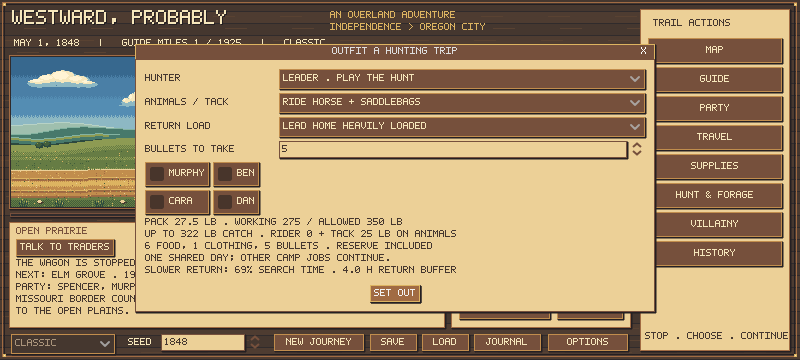

# Hunting return time and farmer results

Slower loaded returns now reserve search time within the same hunting day. The follow-up also tested pace and starting outfits. **The experimental lean outfit underperformed; the suggested outfit is unchanged. Overall farmer survival remains open.**

## What changed

The outfitter shows search time remaining and the planned return buffer before setting out. A fit solo horse with bags retains 100% baseline search with normal riding, about 91% with heavy riding, 83% when leading home and 69% when leading heavily loaded. The hauling allowances themselves are unchanged. A companion already away on a multi-day trip does not pay the outward journey twice, and only its final hunting day reserves the return time. Earlier days and stranded-camp survival retain their previous search opportunities.

The actual interactive aiming duration, hit rules, ammunition cost, carcass yields and one-day/one-meal settlement are unchanged. Separate deterministic opportunity rolls reduce potential game when less search time remains. The model uses authored fair-weather planning assumptions, not measured 1848 hunting hours. See [model and study design](HUNTING_RETURN_TIME.md).

## Validation

Source checkpoint **d1f2f9c** passed **69 Godot suites**, including **1,393 return-planning checks**, plus **24 store and 20 current-policy outlaw journeys** in an isolated checkout. A genuine immediately preceding active led-trip save preserves inventory, state and RNG on load. Native Godot leader/companion outfitting was reviewed.

The same frozen source completed **2,016 primary journeys** with zero state/save/policy/source errors: 1,008 development and 1,008 held-out journeys. Six seeds per phase were reused across three professions, May/July departures, seven hunting strategies and four pace/outfit combinations. They are paired comparisons, not 2,016 independent worlds. Deaths and the test-only one-year cap remain outcomes.

All primary input names, SHA256 digests, rules and source hashes are in [the compact archive](hunting-return-time-summary-01.json). Full archives are preserved under ignored .tools. The old 1,428-journey study is an earlier source/policy cohort; do not pool it with this one.

## Previous-version control

An additional **42 control journeys** use the previous game version (08eca17) with exactly the new study runner and the same development worlds: farmer, May, steady pace, lean outfit. Only the runner was copied into that checkout; game/data files were left at the old commit. The before/after source fingerprints and paired outcomes are [archived separately](hunting-return-time-control-01.json).

All 24 cases using unaffected legacy/foot/normal-riding/wagon methods matched their recorded outcomes, days, inventory totals, progress, audits and activity counts. Newly added time-planning fields in rejected-quote diagnostics were excluded from that comparison. The remaining 18 heavy/led/outrider cases may diverge because fewer opportunities change later food, health and decisions. Aggregate meat over an entire journey need not fall monotonically: a struggling party may hunt more often. This small control verifies isolation, not an independent balancing result.

## Held-out farmer arrivals

Each cell below has **12 journeys**: six seeds across May and July. Practical equipment costs apply, including $58 for a horse/saddle/bags only in mounted and outrider strategies. All other policies remain matched.

| Hunting strategy | Cautious, standard | Steady, standard | Cautious, lean | Steady, lean |
| --- | ---: | ---: | ---: | ---: |
| Legacy group | 3/12 | 1/12 | 0/12 | 0/12 |
| Outfitted foot group | 5/12 | 3/12 | 0/12 | 0/12 |
| Ride home | 1/12 | 1/12 | 0/12 | 1/12 |
| Heavy riding | 2/12 | 4/12 | 1/12 | 0/12 |
| Lead home | 2/12 | 3/12 | 2/12 | 0/12 |
| Wagon hunt | 4/12 | 4/12 | 0/12 | 0/12 |
| Companion outrider | 0/12 | 2/12 | 0/12 | 0/12 |

The standard outfit has six oxen and 1,700 food. The experimental lean outfit has four oxen and 1,200 food, leaving $85 more starting cash while retaining clothes, ammunition, spares, care kits, salt and dried produce. It also loses two spare oxen that could otherwise provide emergency meat. It is a meaningful resource tradeoff, not a free cash improvement.

Under these policies, cutting the initial food reserve was generally harmful. **Do not replace the suggested outfit with the lean test outfit.** Neither higher starting money nor lower historical prices was introduced to compensate.

## Pace, risk and controls

The totals below combine seven methods, so each cell represents 84 scripted journeys sharing the same six world seeds. This helps compare patterns; it is not an independent-sample probability estimate. Parentheses show arrivals with all five original travelers surviving, including any genuinely alive away hunter. Reunited counts are separate in the archive.

| Policy | Farmer arrivals (five originals alive) | Carpenter | Banker |
| --- | ---: | ---: | ---: |
| Cautious, standard | 17/84 (3) | 62/84 (51) | 82/84 (80) |
| Steady, standard | 18/84 (0) | 74/84 (50) | 80/84 (77) |
| Cautious, lean | 3/84 (0) | 35/84 (9) | 73/84 (60) |
| Steady, lean | 1/84 (0) | 35/84 (6) | 78/84 (65) |

For pairs that arrived under both standard-outfit pace policies, the following are matched steady-minus-cautious duration differences. They describe that surviving subset only; one cannot infer faster or safer travel for every party.

| Profession | Matched pairs arriving both ways | Median day difference |
| --- | ---: | ---: |
| Farmer | 7 | 1 |
| Carpenter | 57 | -28 |
| Banker | 78 | -30.0 |

Steady pace offers a real speed/risk choice, but it does not solve farmer food shortages by itself. Fewer rests or faster travel can change illness, animal condition and who survives. More arrivals and more intact arrivals are different objectives. The new return-time cost removes a free advantage; it does not require all hunting methods to produce equal outcomes.

## Remaining work

These scripts still lack intelligent camp-work assignments, emergency one-day delegation when the leader cannot haul, deliberate rescue of stranded hunters and human judgment about stores and nutrition. They should not be treated as optimal farmer play. In particular, a player can have companions forage, nurse and process meat alongside a leader hunt; the current policies do not actively organize those jobs.

The next useful farmer comparison is coordinated companion work and food/produce planning, followed by a human playtest. Keep the existing prices, funds and suggested food until evidence supports a concrete change. No general travel speed, health curve, food conversion, animal capacity or new disease/combat mechanic changed in this pass.

## Reproduce

Run tests/hunting_balance_campaign.gd with a fresh label, --professions=farmer,carpenter,banker --months=5,7 --equipment=practical --seeds=6. Use --pace=0 or 1 and --outfit=standard or lean for four shards per phase. Development starts at 105000; held-out validation at 115000. All reports refuse overwrite. Summarize the eight current-source archives with tests/summarize_hunting_balance.py.

For the previous-source control, use a separate checkout at 08eca17, copy only tests/hunting_balance_campaign.gd from d1f2f9c, and run --professions=farmer --months=5 --equipment=practical --seeds=6 --seed-start=105000 --pace=1 --outfit=lean. Keep its report separate because rules/source hashes intentionally differ.
