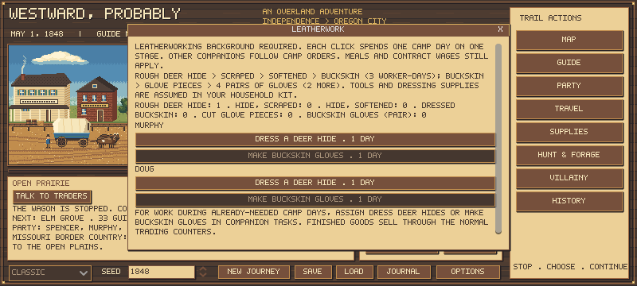

# Leatherworking background and hide-to-goods crafting

**Leatherworking is now a primary companion background**, alongside Hunting, Carpentry, Caregiving and Trading. Select it in character creation's Background dropdown; it does not consume a special-trait slot. Generated companions can also have this background. Its authored mercenary base is75 cents/day before existing modifiers, and it qualifies for the existing paid leather/harness repair jobs.

Carpenters still repair wagons and take carpentry jobs. No carpenter manufacturing system was present, and none was added here.

## Make goods from your own hides

Open **Camp > Leatherwork** for a one-day stage performed by a chosen available leatherworker. Or assign **Dress deer hides** / **Make buckskin gloves** in the existing Companion Tasks roster. Standing tasks use the stopped days you already spend resting, hunting or doing other camp work; they do not add a separate day automatically. The worker is occupied and does not also perform another task. Ordinary party meals, weather, health and contract wages still apply.

| Stage | Consumes | Produces | Worker time |
|---|---|---|---:|
| Scrape / begin dressing | 1 rough deer hide | 1 scraped hide | 1 day |
| Soften / continue dressing | 1 scraped hide | 1 softened hide | 1 day |
| Finish dressing | 1 softened hide | 1 dressed buckskin | 1 day |
| Cut gloves | 1 dressed buckskin | 1 batch of glove pieces | 1 day |
| Sew gloves | 1 batch of glove pieces | 4 pairs of buckskin gloves | 1 day |

The starting deer hide is the rough trade skin already recovered through hunting. Its original hunting/rough-recovery cost is separate: this chain adds five worker-days. Bison hides and rabbit pelts are not glove inputs in this initial recipe set. The recipes are data-driven for later expansion.

Unfinished work is **physical cargo**, not an invisible progress meter. Scraped/softened hides weigh3 lb, dressed buckskin and a glove-piece batch2 lb, and each finished pair0.25 lb. You can save/load, pack, cache or discard these items. Morning material reservation prevents two workers consuming the same skin or using a newly produced intermediate before the next day. A worker who becomes unavailable before completion does not award output or destroy the unconsumed input.

Patients being nursed cannot craft. An artisan employed for wages cannot also make your goods that day. Unselected people may continue nursing/resting while someone crafts. Direct one-day actions also support an acting leader whose background is Leatherworking. Dressing requires water; work is unavailable while on a river-travel leg. Existing winter/exposure costs still apply.

## Sell through the shops

Finished buckskin and gloves appear at existing open post/passing-trader counters, including mixed supply baskets. No separate selling interface was added. Buyers have saved finite demand; repeated visits/loading do not replenish it. Unfinished stages have no buyer in this release.

| Finished trade good | Post offer | Road offer | Post / trader demand |
|---|---:|---:|---:|
| Dressed buckskin | $1.25 | $0.93 | 8 / 2 |
| Buckskin gloves, pair | $0.75 | $0.56 | 20 / 6 |

These prices, masses, stage counts and four-pair yield are **authored estimates**, not a verified1848 Oregon tariff or measured garment pattern. Crafting is not guaranteed to cover a hired artisan's wages or an extra whole party's camp costs. Shared necessary camp time and buyer access can matter more than gross receipts. Gloves are trade goods; they do not replace a full clothing set or grant a new health bonus.

## Historical basis and simplification

NPS documents Tabitha Brown buying needles, trading old clothing for deerskin and making gloves commercially after reaching Oregon in1846. This supports the activity, not our unit prices or labor/yield coefficients. [NPS account](https://www.nps.gov/articles/000/tabitha-brown-the-oregon-trail.htm).

NPS distinguishes dressed/tanned leather from untreated skin and describes traditional smoke, brain and oil treatments. Our staged process avoids treating an air-dried hide as immediately usable glove leather. It abstracts hand tools and dressing supplies into the existing household kit rather than simulating individual needles, brains, oils and chemicals. It does not model industrial bark tanning. [NPS leather and skin guidance](https://www.nps.gov/subjects/museums/upload/MHI_AppS_LeatherSkin.pdf).

## Compatibility and verification

The earlier Leatherworker special remains **legacy-only cross-training** for saved travelers and already generated offers. Their original background, ability, contract and15-cent premium are preserved; no forced respec or refund occurs. It is absent from new creation choices and new random special generation. New Leatherworking backgrounds use the normal background wage calculation, not that old premium.

A genuine pre-crafting save with two deer hides and a Leatherworker perk was captured before rule edits: `tests/fixtures/pre-leathercraft-save-v1.json`, fingerprint `f0faa29ef2bc76a8045e05b8516eb9a6e03b4e61b6db084074258a3fb3338637`. Migration retains its state/profiles and gives no free crafting materials or finished goods. Missing new inventory fields mean zero. Invalid material counts reject. Stage counts and labels live in `data/leathercraft.json`; regular inventory/counter/cache/field systems carry the actual items.

Focused checks cover the full real chain and sale, exact meals/time, background-only eligibility, rejection of unskilled work, shared input reservation, no same-day stage chaining, nursing/employment conflicts, unfinished saves/packs, malformed counts, old perk preservation, large unit-based sales and real creation/crafting UI commitment. Previous journey comparisons remain frozen prior-rule evidence; no new balance claim is made here.

All **96 Godot suites pass**; final action-gate/UI/compatibility refinements also pass48 leathercraft,576 catalog and46 work-crew checks. Full log `.tools/leathercraft-full-tests-01.log` (SHA-256 `17a5fba02b760de0b879725f32492c62bde423d478cc7b4081f07839ea7af503`), final focused logs `.tools/leathercraft-{focused,catalog,crews}-final.log`. Native crafting panel inspected at800x360 with materials and action buttons visible. A separate source audit matches the old fixture fingerprint to released master8a53c67.
