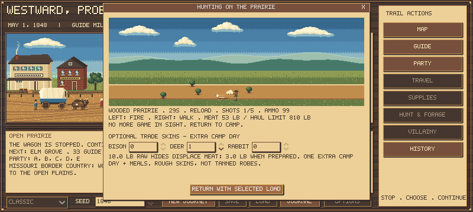

# Pelts and trade goods: first playable slice

Hunted bison, deer and rabbits can now provide rough trade skins as well as food. Recovery is an explicit choice on the **player-led hunting screen**, including group and wagon hunts. The normal meat-only return remains available.

## Using it

After taking game, choose quantities under OPTIONAL TRADE SKINS, then press **RETURN WITH SELECTED LOAD**. The preview shows raw hauling weight, prepared weight and the extra day/meal cost. Leave quantities zero, or close with X/Escape, for the usual meat-only return.

Only actual kills provide skins. Raw skin weight displaces meat within the same hunting party's return allowance, and counts toward mounted load/wear. Preparing the selected batch costs **one additional camp day and real meals**, with the usual weather, health and parallel camp work. The batch is capped at60lb raw skins; a wagon does not remove this labor limit. No extra ammunition is spent merely processing an already killed animal.

Prepared skins must fit the surviving party's actual cargo space. Anything that cannot fit is left behind and recorded. Recovery/preparation appears in the journal and supply history; the report includes its extra meal. Skins are non-food cargo: view them in Supplies' inventory/gear ledger, carry or cache them, or drop chosen quantities through Drop Supplies.

Sell them through open post stores and passing traders, alongside the existing supplies basket. Buyers have finite demand per location/encounter; passing traders also retain their existing cash-purse limit. You can offset purchases with skin proceeds in the same basket. Skins cannot be bought back from these counters, and revisiting or loading a save does not refresh demand. Emigrant families are not skin buyers in this first slice.

| Rough prepared good | Raw retrieval weight | Carried weight | Base post offer | Passing trader offer | Post / trader demand |
|---|---:|---:|---:|---:|---:|
| Bison hide | 50lb | 12lb | $1.50 | $1.12 | 6 / 1 |
| Deer hide | 10lb | 3lb | $0.60 | $0.45 | 16 / 3 |
| Rabbit pelt | 0.5lb | 0.2lb | $0.05 | $0.03 | 40 / 8 |

These are supplementary opportunities, not guaranteed profitable actions. An extra day's meals, displaced meat, transport weight and an actual trading visit can outweigh a small sale. There is no increase to starting money, meat calories or existing food prices.

## Historical grounding and simplification

NPS describes roughly$3 as contextual average buffalo-robe value at Bent's Fort in the1830s/1840s, varying with season and quality. That was a different trail/market; it is not an1848 Oregon-route price list. [NPS: Connections Across the High Plains](https://home.nps.gov/articles/000/hpg-connections.htm).

NPS also distinguishes the fully processed robes of the earlier trade from raw hides. Its account of1846-47 Cheyenne robe preparation describes repeated work over several days. This slice therefore does **not** award finished robe value for a fresh kill. [NPS: Hunting and Processing Bison Robes](https://www.nps.gov/articles/000/beol_business-of-bison.htm).

The game's output is a roughly scraped/air-dried trade skin. All quoted skin prices, wet/dry weights, buyer demand,60lb work batch and the single additional preparation day are **authored estimates**. The buffalo-robe reference supplies context, not a measured conversion to our$1.50 rough hide. Deer/rabbit prices are provisional, without verified local1848 tariffs. Drying weather, individual hide quality/season, full tanning and gradual deterioration are not simulated here. Rough preparation and storage durability are simplified for this first slice.

## Scope and compatibility

The first release covers player-led hunts and physical skin trading. Autonomous hunters keep their existing meat routine; scheduling their skin preparation needs an explicit task/outfitting choice. Personal heirlooms, companion ownership, valuables kept for an Oregon score bonus and a broader goods catalogue remain subsequent work. No new art or proprietary assets were introduced; the preview uses the existing original game artwork.

A genuine pre-pelt save was captured before editing the rules and is tested unchanged. Its existing state, resources and random streams are preserved. New goods are optional zero-quantity fields when absent, including older cached and detached inventories. Invalid counts and unknown inventory goods are rejected. A legacy outrider cannot inherit new trade goods or temporary raw load from the wagon.

## Validation

All **91 Godot suites pass**, including **70 focused checks** covering kill provenance, atomic rejection, raw-versus-prepared mass, extra time and meals, repeat recovery, saves, old state preservation, pack/cache isolation, finite demand, exact sale money, mixed baskets, discard weight and actual visible return-button commitment. The rendered hunting dialog was inspected at800x360 and fits with the committing button visible. No replacement game art was generated.

Four meat-only journey replays (standard May farmer/planning65, seeds545000-545003) retain the prior outcomes, days, supplies, counters and other recorded fields. One diagnostic outbound-pack quote now contains three zero-count skin slots; the verifier removes only those documented zero slots before comparison. This is compatibility evidence, not a measured farmer survival gain from skin trading.

Frozen runtime472de10; [compact validation](pelts-validation-01.json), verifier `tests/summarize_pelt_validation.py`. Final suite log `.tools/pelts-final-tests-03.log`; opt-out report `.tools/hunting-pelts-optout-parity-02.json` and hash copy `.tools/pelts-validation-archives/`. Earlier failed development logs are retained and excluded from final validation. The economy feature is not a new broad balance pass; no claim that it solves the calendar or survival constraints.
