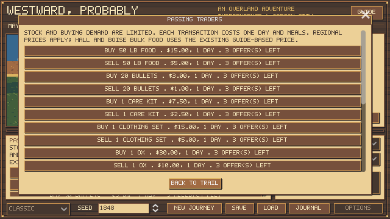
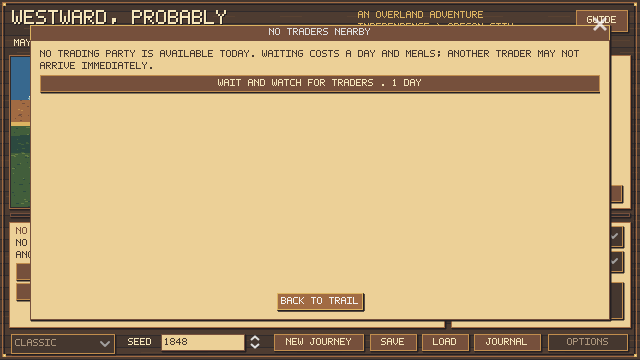
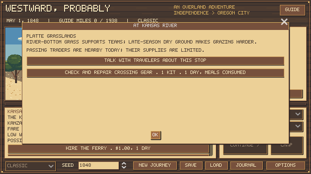

# Regional travel, trading and landmark activities

October 22, 2026. First connected implementation, with original art and original paraphrased conversations. Numerical settings are authored game tuning.

## How to use it

Open **People & Places → Local Conditions / Stop Activities** for regional guidance, current trader availability and activities at the present landmark. Open **Supplies → Buy / Trade** for offers or the option to wait. Existing stop backgrounds remain in use.

## Regional conditions

The existing five route habitat assignments now also guide weather selection, prices, passing-trader frequency and grazing strain. Rain/fog and cold/snow selection weights change by region; the existing monthly cold gate, terrain effects, exposure, river stage and regional hunting pools still apply. These broad regions are not a reconstructed daily climate series.

| Region | Passing window / cycle | Price multiplier | Daily working-team strain | Rain/fog weight | Cold/snow weight |
| --- | --- | ---: | ---: | ---: | ---: |
| Blue Mountains and Cascades | 4 / 10.0 days | 1.20 | 1.0 | 1.40 | 1.40 |
| Rocky Mountain country | 4 / 12.0 days | 1.15 | 1.0 | 0.90 | 1.70 |
| Platte grasslands | 4 / 10.0 days | 1.00 | 0.0 | 1.00 | 1.00 |
| Snake River country | 4 / 14.0 days | 1.35 | 1.0 | 0.55 | 0.90 |
| Missouri border country | 4 / 8.0 days | 1.00 | 0.0 | 1.10 | 1.00 |

July–September adds one working-team strain point in plains and sagebrush country. Ordinary non-travel days restore two team-condition points; full rest restores four. Walking does not incur pulling strain. Existing food, fatigue, human illness, clothing, weather, load and small-team limits remain active. Water scarcity is currently contextual guidance and a grazing-pressure proxy, not a separate water inventory or drinking-source simulation.

## Trading opportunities

Passing traders appear during four-day windows in regional cycles; the seed offsets the schedule. Inspection, cancellation, reloading and reopening do not reroll availability. Waiting consumes one real day, ordinary meals and daily health/weather progression. No immediate arrival is promised. Established trading posts remain accessible while stopped there, subject to stock and affordability. Early Kearny remains a construction site, not a full supply shop.

Each passing party permits three transactions per commodity and direction; a post permits eight. Buying and barter draw from the same commodity offer quota. Selling has its own finite demand quota and does not refill buying capacity. These are discrete offer limits, not a full merchant-pound inventory or shopkeeper economy. Stock is shared across reopening and saves. Post quotas persist for the journey; passing stock is new only with another regional cycle.

Regional premiums apply to purchased goods. The existing explicit post bulk-food quantities and prices take precedence: 200-lb lots and the prior Hall/Boise guide-based reference price. Other goods, including oxen and salt, cost more in the west. Sales and barter retain existing authored terms. Every completed transaction costs a day and meals. Price and remaining offers are visible before purchase. A subsequent care/defense update restricts paid local help to selected stopped posts; see [care and save findings](CARE_COMBAT_AND_SAVE_REVIEW.md). The results below remain the earlier regional-rule snapshot.

## Stop activities

Twelve stops now offer original contextual traveler conversations, alongside existing landmark notes. Free conversation supplies guidance without advancing time or rerolling weather. The new practical activities are:

- Ash Hollow, Soda Springs and Grande Ronde: seek a better grazing camp. One day and normal meals; ordinary resting benefits plus eight team-condition points. One use per stop; only offered with animals.
- Kansas River, Green River and Snake River: check and repair crossing gear. One care/repair kit, one day and normal meals. Preparation multiplies accident risk by 0.85 at that crossing, a relative 15% reduction. It does not guarantee success or make high water safe. One preparation per crossing.
- Conversations at South Pass, Fort Laramie, Fort Hall, Fort Boise, early Kearny and Laurel Hill explain local travel or supply concerns. No fictional person is presented as an actual historical witness.

Activities remain at the stop; they do not accidentally pay the ferry, leave the landmark or advance the route. Their completion, preparation and used stock persist in saves. A verified pre-update save migrates with empty new ledgers while retaining its animals, goods, cash, health, time and random states. Existing pending quotes are honored; subsequent offers use the new rules.

## Historical grounding and limits

[NPS: Traveling the Emigrant Trails](https://www.nps.gov/articles/000/traveling-emigrant-trails.htm) supports the importance of grass, winter timing, costly fort supplies and limited demand for discarded goods. [NPS: Making the Trek](https://home.nps.gov/oreg/learn/historyculture/making-the-trek.htm) describes increasing supply scarcity and mountain barriers farther west. [NPS: Fort William and Fort John](https://www.nps.gov/places/fort-william-and-fort-john.htm) distinguishes the trading post in the 1840s from its military purchase in 1849. Existing route research and Palmer references remain in the earlier source ledger.

Those sources do not establish these exact cycle lengths, stock quotas, weather weights, team damage or preparation bonuses. Merchant prices beyond explicit guide references and all dialogue are authored. There are no new purchased third-party graphics. Regional boundaries reuse broad habitats; finer local weather, explicit water sources, individual cattle nutrition and historical merchant stock records remain future depth.

## Automated survival results

8,280 new-rule journey attempts: 360 ordinary-policy runs, 6,480 matched team/preservation/emergency runs and 1,440 rebuilding follow-ups. Seeds 0–19, three professions, March/May/August starts. Experiments use real public actions, 65% scripted hunting aim, meals, health, rest, preservation and crossing rules. The expanded policy rests a worn team, considers stop activities, avoids exhausted offers, waits for replacement-animal opportunities, and can repack found cache food while waiting. These strategies differ from the older study; cross-version numbers are descriptive rather than a controlled estimate of a single rule change.

Arrival means at least one survivor. Family survival is reported separately. The emergency studies force loss of the herd at mile 600, or mile 1,600 for late walking; those losses are test scenarios, not historical frequency claims. A party that dies before the forced emergency stays in the denominator. The experiment ends at 365 days or 2,400 actions, so a limit is not counted as a death.

### Ordinary journeys

| Policy | Profession | Arrivals | All five arrive |
| --- | --- | ---: | ---: |
| hunting_preserve | farmer | 52/60 | 31 |
| hunting_preserve | carpenter | 60/60 | 60 |
| hunting_preserve | banker | 60/60 | 60 |
| spare_ox | farmer | 51/60 | 47 |
| spare_ox | carpenter | 60/60 | 60 |
| spare_ox | banker | 60/60 | 60 |

### Emergency strategies, bonus enabled

Each row pools four- and six-ox starting outfits, professions, months and seeds. Four-ox outfits retain $40 more starting cash. Rebuilding means buying or bartering toward four oxen while resources permit. Every transaction, waiting day, return mile and hitching day uses the ordinary engine. The one-animal replacement policies are emergency mobility tests, not optimal recovery strategies.

| Strategy | Arrivals | All five arrive | Wagon recovered | Cache lost | Death outcomes | Limit | Policy blocked |
| --- | ---: | ---: | ---: | ---: | ---: | ---: | ---: |
| emergency_trade | 0/360 | 0 | 0 | 0 | 53 | 307 | 0 |
| emergency_walk | 0/360 | 0 | 0 | 0 | 360 | 0 | 0 |
| emergency_return | 0/360 | 0 | 264 | 96 | 133 | 227 | 0 |
| emergency_last_ox_walk | 0/360 | 0 | 0 | 0 | 360 | 0 | 0 |
| late_walk | 25/360 | 6 | 0 | 0 | 335 | 0 | 0 |
| rebuild_trade | 311/360 | 221 | 0 | 0 | 40 | 9 | 0 |
| rebuild_return | 210/360 | 148 | 264 | 96 | 131 | 19 | 0 |

### Team bonus check

| Starting oxen | Paired arrivals | Median days saved by bonus | Bonus-only arrivals | Control-only arrivals |
| ---: | ---: | ---: | ---: | ---: |
| 4 | 636 | 0 | 0 | 0 |
| 6 | 592 | 18 | 69 | 24 |

Walking is substantially harsher under scarce traders. This remains an emergency option, and the low late-walking success rate needs human playtesting rather than being presented as settled difficulty. Early walking the remaining road is not guaranteed to work. Rebuilding a functioning team and recovering a cache are distinct strategies. Backtracking still does not replay intermediate river decisions; nearby refuge, pack animals and alternative transport are not newly implemented.

## Verification and reproduction

The complete regression suite passes, including 47 regional/context checks and 12 prepared-party full-road journeys. Native trader-stock, waiting and local-activity screens were rendered and inspected; the actual activity button was exercised. Checks cover finite stock/demand, real waiting costs, no stock rerolls, post prices, save persistence, malformed data, pre-update saves, regional weather samples, forage strain and preparation costs/effects. Automated results do not substitute for a human playtest or historical mortality calibration.

Run `test.ps1` for normal regressions. Run `tests/full_trail_balance.gd -- --oxen --label=regional-first-pass`, `tests/team_survival_study.gd -- --label=regional`, and the latter with `--rebuild` for these archives; then run `tests/write_regional_report.py`. Older reports remain snapshots of earlier rule signatures.

[360 ordinary journeys](regional-first-pass-oxen.json) · [6,480 matched journeys](regional-survival-study.json) · [1,440 recovery follow-ups](regional-rebuild-study.json)

