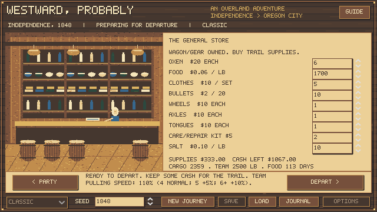
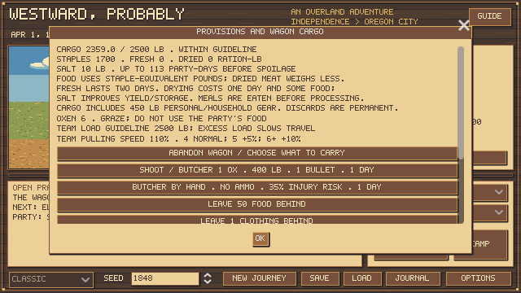

# Teams and emergency survival

**Archived balance snapshot:** these results precede regional weather/forage and scarce traders. See [the current regional rules and experiments](REGIONAL_TRAVEL.md) for the subsequent implementation.

October 22, 2026. Matched simulation study; no human playtest or historical death-rate calibration.

## Team rule

The shop still suggests six oxen. Four is the normal pulling baseline; one to three retain the existing penalties. Weather, load, condition, fatigue and terrain apply afterward, and daily mileage rounds to whole miles. One overburdened ox can be considerably slower than its nominal 25% team factor.

| Oxen | Pulling-speed factor |
| ---: | ---: |
| 0 | Wagon stops |
| 1 | 25% |
| 2 | 50% |
| 3 | 75% |
| 4 | 100% |
| 5 | 105% |
| 6 or more | 110% |

Extra oxen do not enlarge the 2,500-lb wagon load guideline. Smaller teams retain the 625-lb-per-animal guidance. Extra animals provide replacement stock and potential emergency meat; grazing is assumed, so herd upkeep remains simplified. These speed percentages are authored tuning and can be flattened in `data/survival_rules.json`.

## Historical basis

[NPS's Murphy wagon interpretation](https://www.nps.gov/places/murphy-wagon-replica.htm) gives four to six oxen for that wagon size. [BLM's education guide](https://www.blm.gov/sites/default/files/learn_interp_nhotic_edguide.pdf) recommends at least four with a spare pair when possible. Neither establishes a 5%/10% speed increase; a spare pair need not always be hitched. Palmer's 1847 advice for a lone wagon recommends four yoke (eight animals), illustrating variation in recommendations and reserve requirements. We distinguish that outfit advice from animals actively pulling.

## Experiment

6,480 initial full-journey attempts, plus a 1,440-journey rebuilding follow-up (7,920 total): four or six starting oxen, bonus enabled or flattened, nine policies, three professions, March/May/August starts, seeds 0–19. Animals are bought at normal prices; the cheaper four-ox outfit retains $40 more cash. Controls flatten only the bonus, leaving small-team penalties and load rules intact. Profiles include fresh meat, drying, salt, optional spare-animal slaughter, and forced herd-loss emergencies after mile 600, plus a late walking emergency after mile 1,600. No free cash, meat, replacement animals or cache recovery is granted.

The scripted hunter uses 65% aim with the existing health, rest, rations, care, trade, weather and river rules. Walking maximizes food after a declared pack of clothing, ammunition, one kit and salt. It uses the normal hard pack limit; later overload is discarded through public actions. Its resupply and hunting threshold scales to half the available food space (at most 30 lb); foot parties skip oversized bulk-post lots. This avoids a wagon-sized shopping target trapping a pack-limited party in repeated purchases. The return policy advances on two actual walking days, backtracks with real meals and time, rolls ordinary cache loss, then attempts to buy/barter an ox and hitch the wagon. A separate policy slaughters the final animal before packing. Forced herd losses are scenario fixtures, not estimated historical frequencies.

Fresh-only/dry/salt profiles isolate preservation choices. Optional slaughter retains one ox by policy; the emergency final-ox profile deliberately takes the last animal. Parties dying before the emergency remain in the denominator; the triggered count is shown separately. A maximum of 365 days or 2,400 actions ends an unfinished attempt.

## Outcomes

Each row contains 180 attempts across professions, months and seeds. Arrival means at least one survivor. Median days includes arrivals only and is not directly comparable across rows with different surviving parties.

| Policy | Start oxen | Bonus | Arrivals | All five arrive | Emergency triggered | Median arrival days |
| --- | ---: | --- | ---: | ---: | ---: | ---: |
| fresh | 4 | off | 142/180 | 142 | 0 | 200 |
| fresh | 4 | on | 142/180 | 142 | 0 | 200 |
| fresh | 6 | off | 128/180 | 128 | 0 | 202 |
| fresh | 6 | on | 146/180 | 146 | 0 | 184 |
| dry | 4 | off | 171/180 | 149 | 0 | 205 |
| dry | 4 | on | 171/180 | 149 | 0 | 205 |
| dry | 6 | off | 169/180 | 141 | 0 | 206 |
| dry | 6 | on | 173/180 | 155 | 0 | 186 |
| salt | 4 | off | 175/180 | 150 | 0 | 205 |
| salt | 4 | on | 175/180 | 150 | 0 | 205 |
| salt | 6 | off | 174/180 | 142 | 0 | 208 |
| salt | 6 | on | 175/180 | 156 | 0 | 186 |
| salt_slaughter | 4 | off | 157/180 | 152 | 0 | 204 |
| salt_slaughter | 4 | on | 157/180 | 152 | 0 | 204 |
| salt_slaughter | 6 | off | 173/180 | 167 | 0 | 205 |
| salt_slaughter | 6 | on | 175/180 | 171 | 0 | 186 |
| emergency_trade | 4 | off | 0/180 | 0 | 180 | — |
| emergency_trade | 4 | on | 0/180 | 0 | 180 | — |
| emergency_trade | 6 | off | 0/180 | 0 | 180 | — |
| emergency_trade | 6 | on | 0/180 | 0 | 180 | — |
| emergency_walk | 4 | off | 0/180 | 0 | 180 | — |
| emergency_walk | 4 | on | 0/180 | 0 | 180 | — |
| emergency_walk | 6 | off | 0/180 | 0 | 180 | — |
| emergency_walk | 6 | on | 0/180 | 0 | 180 | — |
| emergency_return | 4 | off | 0/180 | 0 | 180 | — |
| emergency_return | 4 | on | 0/180 | 0 | 180 | — |
| emergency_return | 6 | off | 0/180 | 0 | 180 | — |
| emergency_return | 6 | on | 0/180 | 0 | 180 | — |
| emergency_last_ox_walk | 4 | off | 0/180 | 0 | 180 | — |
| emergency_last_ox_walk | 4 | on | 0/180 | 0 | 180 | — |
| emergency_last_ox_walk | 6 | off | 0/180 | 0 | 180 | — |
| emergency_last_ox_walk | 6 | on | 0/180 | 0 | 180 | — |
| late_walk | 4 | off | 64/180 | 60 | 177 | 265 |
| late_walk | 4 | on | 64/180 | 60 | 177 | 265 |
| late_walk | 6 | off | 61/180 | 57 | 178 | 261 |
| late_walk | 6 | on | 67/180 | 60 | 180 | 256 |

## Matched bonus effects

Only pairs where both attempts arrive contribute to the duration comparison. Same seed, starting team, profession, month and policy are paired. This avoids attributing a change in the set of survivors to travel speed.

| Start oxen | Both arrive | Median days saved | Bonus-only arrivals | Control-only arrivals |
| ---: | ---: | ---: | ---: | ---: |
| 4 | 709 | 0 | 0 | 0 |
| 6 | 687 | 15 | 49 | 18 |

## Emergency and cache details

| Policy | Bonus | Packed | Spent days on foot | Cache lost | Wagon recovered | Backtracking days | Swimming crossings | Policy blocked | Day/action limit |
| --- | --- | ---: | ---: | ---: | ---: | ---: | ---: | ---: | ---: |
| emergency_trade | off | 0 | 0 | 0 | 0 | 0 | 0 | 0 | 307 |
| emergency_trade | on | 0 | 0 | 0 | 0 | 0 | 0 | 0 | 303 |
| emergency_walk | off | 360 | 360 | 0 | 0 | 0 | 941 | 0 | 7 |
| emergency_walk | on | 360 | 360 | 0 | 0 | 0 | 947 | 0 | 8 |
| emergency_return | off | 360 | 360 | 144 | 216 | 798 | 349 | 0 | 198 |
| emergency_return | on | 360 | 360 | 117 | 243 | 786 | 292 | 0 | 216 |
| emergency_last_ox_walk | off | 360 | 360 | 0 | 0 | 0 | 930 | 0 | 22 |
| emergency_last_ox_walk | on | 360 | 360 | 0 | 0 | 0 | 944 | 0 | 13 |
| late_walk | off | 355 | 355 | 0 | 0 | 0 | 835 | 0 | 1 |
| late_walk | on | 357 | 357 | 0 | 0 | 0 | 851 | 0 | 0 |

## Follow-up: rebuild the team

The first emergency policies buy one replacement animal. That is an emergency mobility check, not an optimal recovery strategy. A separate 1,440-journey follow-up instead buys or barters toward four animals after the forced loss or cache recovery, as cash or food permits. Every replacement costs normal money or food, a day, and meals. No other game rule changes. Seeds, professions, months, starting teams and bonus controls are matched to the original experiment.

| Recovery strategy | Start oxen | Bonus | Arrivals | All five arrive | Cache lost | Wagon recovered | Median arrival days |
| --- | ---: | --- | ---: | ---: | ---: | ---: | ---: |
| rebuild_trade | 4 | off | 162/180 | 128 | 0 | 0 | 213 |
| rebuild_trade | 4 | on | 162/180 | 128 | 0 | 0 | 213 |
| rebuild_trade | 6 | off | 159/180 | 119 | 0 | 0 | 213 |
| rebuild_trade | 6 | on | 159/180 | 123 | 0 | 0 | 210 |
| rebuild_return | 4 | off | 95/180 | 74 | 72 | 108 | 213 |
| rebuild_return | 4 | on | 95/180 | 74 | 72 | 108 | 213 |
| rebuild_return | 6 | off | 88/180 | 70 | 72 | 108 | 212 |
| rebuild_return | 6 | on | 117/180 | 83 | 45 | 135 | 213 |

[Raw 1,440-journey rebuilding follow-up](team-rebuild-study.json)

The modest bonus is retained provisionally: matched successful six-ox journeys saved a median 15 days in the main study, while four-ox controls were unchanged. Emergency walking is demonstrably possible late in the route, but carrying a family the remaining distance from mile 600 did not succeed under this policy and one-year cap. Cache recovery and reconstructing a working team are separate choices. A sparse trading-opportunity model and walking to nearby refuge/transport still need deeper design; this experiment does not silently grant those features.

## Limits and reproduction

This evaluates a declared automated policy, not optimal play or player skill. Cash-rich parties prefer ferries, so focused swimming tests complement these journeys. Returning for the cache inherits the current engine limitation: intermediate river decisions are not replayed on backtracking. Passing-wagon trade is always available rather than scheduled; grazing, pack animals, transport bookings, and historical stock scarcity remain simplified. Walking abandonment is an emergency option, not guaranteed rescue. Policy blocks and time limits are reported separately from deaths.

The raw archive includes every attempt, trigger day/mile, final survivors, death causes, food, cash, hunts, preservation, spoilage, slaughter, foot days, cache outcomes, backtracking and river mishaps. Earlier 360-journey archives remain valid snapshots of their own rule signatures, not current-rule results.

Run `tests/team_survival_study.gd` with Godot, repeat with `-- --rebuild` for the follow-up, then `tests/write_team_report.py` to rebuild this report. The ordinary regression suite separately checks deterministic saves, exact pack/cache transfers, actual foot swimming/ferry UI, cache expiry/loss, overload after acquisition and walking arrival.

[Raw 6,480-journey results](team-survival-study.json)

