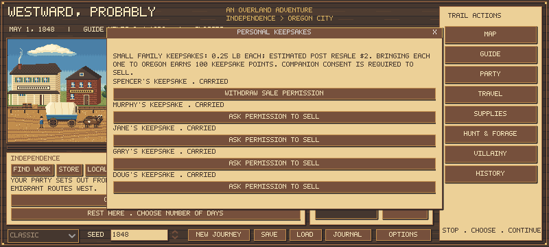
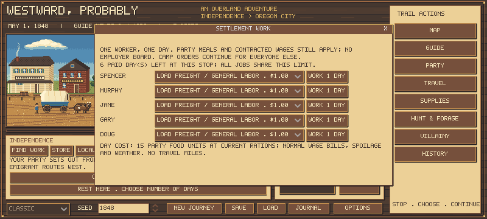

# Money along the trail: keepsakes and settlement work

This adds two income choices alongside [hunted skins](PELTS_AND_TRADE_GOODS.md): selling personal keepsakes and taking finite paid work at selected stops. It does not increase profession funds or change food energy, hunting yields or pelt prices. A combined survival comparison remains the next balance step; these mechanics are not a claim that farmer survival is settled.

## Personal keepsakes

Starting travelers can each bring one small family memento. **MY KEEPSAKE** toggles the leader's item on the party preparation screen; companion choices are in **EDIT**. They are included by default in the visible creation flow. Scripted departures that omit this choice and old saves receive none. Each is a unique object tied to a stable owner ID, not an endlessly replenished commodity. New replacement companions do not spawn saleable keepsakes in this release.

Open **Supplies > Keepsakes** to see what is carried and ask permission to sell. A companion must be present and have at least 50 trust to consent. Permission can be withdrawn, and a fall below that threshold prevents sale even if earlier permission exists. These are game rules, not a psychological model. The leader controls their own item; a deceased owner's belongings become estate goods. No permission takes time or transfers money. Sell through an available post or passing trader, using the existing basket and purse constraints. Buyers do not sell these items back.

| Item | Carried mass | Post offer | Road offer | Retention |
|---|---:|---:|---:|---|
| One small personal keepsake | 0.25 lb | $2 | $1.50 | 100 keepsake points if carried into Oregon |

This is one abstract small-memento class, not a price list for silver watches, large family Bibles, quilts or different metals. The mass, resale and points are explicit authored estimates. No exact local 1848 secondhand tariff was established for such a generic object; the flat offer should not be cited as historical evidence. More specific heirloom types will need their own mass and price research.

Keepsakes use the existing physical cargo paths: packing, cached wagons, discards, wagon sales and detached inventory validation. Objects cannot duplicate between those inventories in a valid save. Normal companion departures take their own currently carried object; they do not teleport one out of a remote cache. Sold, dropped, stolen or unrecovered goods award no points. A carried memorial from a deceased owner still earns its retention points. The arrival screen shows **KEEPSAKE POINTS** separately; these do not grant cash, health or survival bonuses.

## Settlement work

**FIND WORK** appears under the location picture when stopped at a listed site that will deal with the party. It does not appear at generic camps, remote landmarks or passing traders. The window is a compact roster: choose a traveler and a job, then **WORK 1 DAY**. Unavailable jobs have a reason in their tooltip.

| Job | Pay per worker-day | Requirement |
|---|---:|---|
| Load freight / general labor | $1 | An available traveler fit to work |
| Carpentry / repairs | $1.50 | Carpentry background or matching special; carpenter leader qualifies |
| Laundry / household help | $0.75 | Caregiving background or matching special |

One selected traveler works per paid day. All jobs share the site's finite allowance: Independence 6 days, Fort Kearny 4, Fort Laramie 4, Fort Bridger 3, Fort Hall 3, Fort Boise 2, The Dalles 3. Kearny work is unavailable before June. Re-entering a stop, changing jobs, turning east and save/load do not replenish its allowance. These are authored local opportunities, not proven historical employers, guaranteed vacancies or unlimited employment. No work is offered by posts closed to the party or refusing it because of identified crime news.

Work passes a full stopped day without route miles. Weather, illness, food consumption, spoilage, animal care, companion contract wages, field trips and pursuit/wanted checks still occur. Employer board is not included. The earned cash is available for that day's normal automatic companion payments. Pay is committed for the day begun, even if an ordinary health hazard interrupts the worker during settlement; no special workplace injury system is added.

The selected worker cannot also complete their standing camp assignment that day. The order remains for later days; other companions continue their own tasks. An unassigned leader can rest while another traveler works, including being nursed. A patient currently assigned nursing is ineligible for employment. Away/departed/guarding travelers, those below 40 health, severe cases and anyone with a broken leg cannot work. One work visit does not enable the camp roster for journeys that never enabled it.

## Price and wage check

The **1850 Census's contemporary statistical discussion**, summarizing the Commissioner of Patents' **1848** wage inquiry, reports mechanics at **75 cents-$1.50 per day**, with higher exceptions. It also reports field labor with board on a monthly basis, which cannot be substituted directly for a cash day rate without board. This supports the scale of the skilled-work offer; it does not establish our posts' wages. The $1 general and 75-cent household offers are estimates. [Census source](https://www2.census.gov/prod2/decennial/documents/1850c-05.pdf).

There are no pay modifiers based on a traveler's sex, appearance or heritage. Historical labor markets had restrictions this small system does not reconstruct. Background requirements, work quotas and eligibility thresholds are gameplay decisions.

At the opening staple price, five filling-ration travelers eat 15 food units worth 75 cents per day: general work leaves 25 cents before other costs, carpentry 75 cents, household work zero. Actual store prices, produce needs, wages and camp production vary. This arithmetic is not a measured journey result; simultaneous companion food production may matter. Work trades calendar time for money, and the approaching winter remains a cost.

## Compatibility and checks

Income rules are in `data/trail_income.json`. A genuine pre-income save was captured before changing the rule fingerprint: `a3956ab6f95ecd072d5106a64750463b126ad8e4db6c5e38597ae9ba518bb23e`. Its entire prior state is preserved with empty ownership/work records. Current saves store explicit ownership, sale permission and used work days; malformed counts, unknown owners, fractional objects and duplicates across the party/cache/detached packs reject. No migration invents personal valuables or adds money.

Focused integration coverage currently includes **70 checks** for live menu commitment, creation choices, real counter sales, revoked consent, deceased owners, cargo, actual packing/caching, exact save/load, genuine legacy state preservation, duplicate rejection, skill/health/nursing gates, daily meals/time/payment, finite demand and work-funded automatic wages. Native screenshots were rendered with Godot and visually inspected at 800x360. No new artwork was made.

The prior pelt price audit remains [PELT_CALIBRATION.md](PELT_CALIBRATION.md). Autonomous hunters still collect meat only; this change does not silently add skin-preparation labor to their outings. The next combined comparison should opt into keepsake sales/work explicitly and record gross proceeds, food spent, days stopped, party outcomes and arrival dates against matched journeys without those income choices.

Final regression: all **92 Godot suites pass** on implementation `123670171b82b35f56d69fe7d9c262373311a981` (70 income checks, 78 pelt checks; no script/engine errors). Local log `.tools/income-full-tests-01.log`, SHA-256 `4adc3746258dbc1ca968f182be985b75aef2487802a0e129551b154773c01644`. Final import and native preview logs contain no errors. A separate source audit reconstructs the pre-income fixture fingerprint from released master `a879027`. Later changes in this branch are documentation only.
