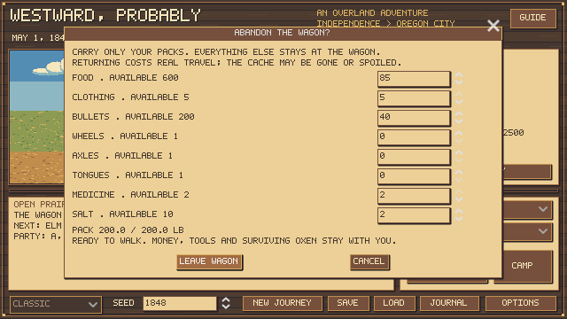
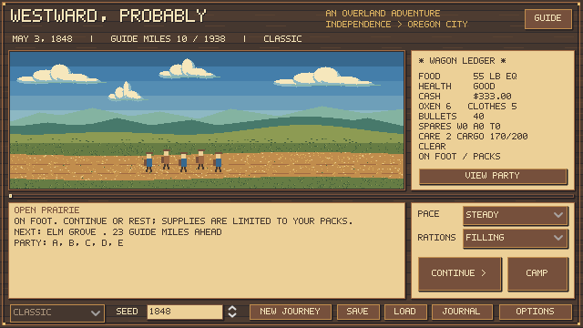
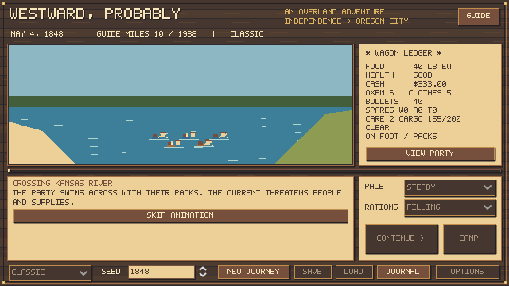
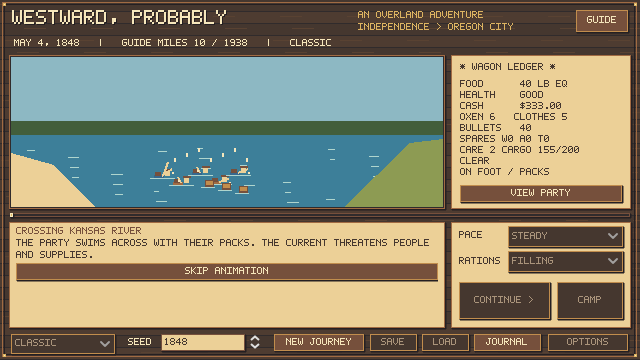

# Small teams, walking packs and wagon recovery

October 22, 2026. These are emergency survival extensions, not a claim to reproduce an original 1985 walking mechanic. All carry weights, walking speeds and cache-loss chances below are authored game baselines requiring further historical and player calibration.

## One ox, or none

One ox can pull the wagon and can be used at departure. Four oxen is the normal pulling baseline; five give +5% speed and six or more +10%, before weather, load, fatigue and team condition. Bonuses cap at six; extra stock remains useful as replacements. The suggested shop outfit remains six animals. These percentages are authored tuning. See [team rules and historical references](TEAM_SIZE.md). Below four animals, the existing team-speed factor falls; smaller teams now also have lower working-load guidance:

| Oxen | Working-load guideline |
| ---: | ---: |
| 0 | Wagon cannot move |
| 1 | 625 lb |
| 2 | 1,250 lb |
| 3 | 1,875 lb |
| 4 or more | 2,500 lb |

This is a soft pulling guideline, distinct from the existing 2,500-lb departure wagon limit. Excess load further reduces speed rather than deleting cargo or forcing an immediate loss. One heavily loaded animal may make only a few miles a day. Discarding cargo or acquiring another animal improves progress. Extra animals provide reserves; they do not enlarge the wagon indefinitely.

You may slaughter the last ox with the same one-bullet or risky hand-tool choices. The review explicitly warns when no team will remain. With no animals, wagon travel stops without spending another day. Camp, hunting, preservation and trade remain accessible, subject to their existing conditions and costs. Trading now uses regional passing-party windows and finite offer limits; a stranded party may have to wait, consuming meals and time. Established posts have persistent limited stock. See [regional travel and trading](REGIONAL_TRAVEL.md).

## Leave the wagon and choose packs

Between stops, open **Supplies → Provisions / Cargo → Abandon Wagon / Choose What to Carry**. An unresolved event must be handled first. The pack screen lists the available quantities and previews weight. Nothing transfers until **Leave Wagon** is pressed; cancellation costs nothing.

- Each living traveler provides a 40-lb carry allowance, including an assumed 15 lb of personal tools/bedding. Five travelers have 200 lb total capacity, of which 75 lb is personal gear. Clothing, ammunition, care kits, salt, food and any selected heavy spares use the remaining capacity.
- Dried food retains the existing distinction between meal-equivalent food and physical mass. A pound of dried meal value does not consume a full pound of pack capacity.
- Unselected inventory stays in the wagon at its actual guide mile. Money and surviving livestock stay with the party. Livestock are led rather than automatically converted into pack-animal capacity.
- Packing takes one camp day, with meals, weather and illness. The party then travels on foot without needing an ox. A nominal 12-mile walking day is modified by pace, weather, terrain, fatigue and pack burden. These are game rules, not a reconstructed travel diary.
- Later deaths or acquisitions may leave the party above its reduced carry allowance. Walking then stops until goods are discarded, repacked or dried; camp activities remain available. The pack-selection screen also enforces the allowance.

The interface displays **ON FOOT / PACKS** and original pixel walkers. Forward river choices offer swimming with packs or a ferry where available. Swimming has an authored 30% mishap chance in low water and 80% in high water, greater than either wagon crossing at the same stage. A mishap injures individual travelers through the existing health system and loses up to 30 lb of food and one clothing set; actual losses are recorded separately from the crossing day's meals. Injuries can be fatal to an already weakened traveler. Ferry travel retains the posted fare and one-day cost without a swimming accident roll. The river animation shows horizontal swimmers, strokes and ripples, with struggling and drifting supplies during a mishap. Walkers stand on dry banks and aboard a ferry; the abandoned wagon is absent. These probabilities are game tuning, not historical estimates. Foot travel has a separate Laurel Hill descent and no wagon portion of the Barlow toll; led livestock still incur their stock tariff. Wagon-only breakdown/fire/swamping encounters are excluded while walking. Hunting retrieval is bounded by available pack room.

## Return, recover, or find it gone

The provisions menu offers **Backtrack to Wagon**. This physically reduces guide mileage to the stored location, crossing route-leg boundaries correctly. Each return day uses walking movement, meals, weather, fatigue and health progression. A party may die before reaching its cache. Recovering the wagon does not restore lost forward mileage: the road must be traveled again.

For an unattended cache, the authored loss chance is 15% plus 3 percentage points per elapsed day since abandonment, capped at 85%. A failed search permanently removes that wagon and its cached supplies. The loss is recorded; reopening menus or loading a save does not reroll it. While standing at a found, guarded wagon, its location is known; departing again exposes it.

On finding the wagon, cached food is aged using its original batch expiry dates. Spoiled meat stays spoiled. With an ox, the party merges the remaining supplies, spends a hitching day and resumes wagon travel from the cache location. With no ox, the wagon remains there: you can repack what you can carry, trade for an animal, or leave on foot again. Transfers conserve inventory and do not duplicate food. Repacking is free in time, like the existing discard/organize action.

Return travel currently resolves as a backtracking action with daily survival updates. It does not replay every intermediate river decision, landmark conversation or random encounter. Forward travel retains normal landmark decisions. Broader route hazards and trader scheduling need further development; the recovery chance is not an historical theft statistic.

## Validation

- 33 oxen checks cover the last-animal choice, zero-team stop, camp preservation, replacement through barter, resumed one-ox movement and scaled load penalties, alongside the prior meat/ammunition/hand-injury cases.
- 44 walking/cache checks cover pack rejection and exact transfers, cash and spares, no-ox walking, real multi-leg backtracking, permanent forced loss, found-wagon repacking without an ox, fresh-food expiry, deterministic save/load recovery, malformed-cache rejection, low/high swimming risks, forced swimming injuries and dated losses, ferry costs, pending/completed crossing saves, upgrading old wading offers without rerolling, foot toll handling, a walking arrival and actual pack/crossing UI signals.
- The complete regression suite passes. Pack selection and walking travel were rendered and inspected. Verified prior saves receive an empty cache without changing their existing supplies or party.
- [The updated 360-journey small-team comparison](reserve-team-small-oxen.json) uses the existing hunter/preservation policy with or without spare-ox use. That policy deliberately retains one animal; the player can choose zero. This is not a full-route balance certification for walking. The earlier two-ox comparison remains archived separately.

