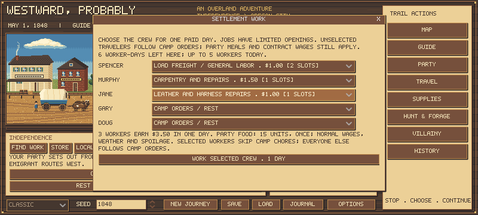

# Paid crews and the Leatherworker specialty

Leatherworking has since been corrected to a primary background and expanded to [physical hide-to-goods crafting](LEATHERCRAFT.md). The special described below is now legacy-only compatibility, not a new creation choice.

Several travelers can now take local jobs during **one paid day**. Individual rates are unchanged as minimum offers; a traveler's existing mercenary market quote supplies a pay floor. This gives hired companions a way to earn their own cash wage while work is available, without inflating pay through a private contract.

## Use it

At a suitable stop, open **FIND WORK** beneath the scene. Each roster row offers **Camp orders / rest** or an eligible job, its actual pay and its daily slot limit. Choose several travelers, review combined earnings and the party's food cost, then press **WORK SELECTED CREW · 1 DAY**. An invalid crew cannot partially commit: no wages, demand, food, clock or random stream changes occur until the complete selection validates.

The whole party eats once and one calendar day passes. Each employee receives a separate wage receipt and uses one of the stop's remaining worker-days. Selected workers skip their camp chores; their standing orders remain for later. Unselected travelers continue camp tasks, including nursing an unselected leader. Nursing patients cannot work. An employed nurse does not also spend a kit or give care.

## Openings and demand

| Role | Existing minimum offer | Daily role slots | Requirement |
|---|---:|---:|---|
| Freight / general labor | $1 | 2 | Available and fit to work |
| Carpentry / repairs | $1.50 | 1 | Carpentry background, relevant special or carpenter leader |
| Laundry / household help | $0.75 | 1 | Caregiving background or relevant special |
| Leather / harness repairs | $1 | 1 | Leatherworker specialty |

A site's concurrent limit also applies: Independence5, Kearny4, Laramie3, Bridger2, Hall2, Boise2, The Dalles4. Its existing total allowance stays6/4/4/3/3/2/3 respectively, now explicitly measured in **worker-days**. Three workers consume three remaining worker-days in one calendar day. Neither save/load nor repeated visits replenishes demand. These limits are authored opportunities, not documented historical vacancies.

## Wages and mercenaries

For each eligible worker, pay is **the higher of the normal job offer and `characters.wage_quote(profile).daily_cents`**. The market quote already includes the existing background, temperament and special modifiers. Free companions use the same calculation; the Mercenary special does not create an extra earning bonus.

A standard contract priced at that market quote can be covered by enough paid days. Actual earnings enter the shared purse before that day's automatic contract payments, so a completed week of work can fund a weekly bill. Food, other companions' wages and existing arrears still cost money. A day of work does not finance a whole week's otherwise unpaid contract, and job availability is not guaranteed.

An unusually generous negotiated contract **does not** raise local offers. For example, agreeing to pay twice the market wage cannot make an employer offer twice as much. Job tooltips show the market quote, the current contract's daily accrual and whether the offer covers that cash accrual. This prevents a money-creation loop through player-controlled terms.

The existing base rates remain estimates informed by the prior wage audit; the quote floor is a requested game rule, not a newly discovered historical tariff. There is no starting-money or food-yield change.

## Leatherworking

**Leatherworker** is a distinct selectable specialty in the existing character-creation special list. It uses one special choice under the normal creation limits, can appear in generated companion offers, and adds15 cents/day to the mercenary market quote. A hunting or caregiving background alone does not qualify someone for this job.

This release covers paid repair work on leather/harness goods using employer-supplied materials. It does not silently convert rough hides into finished leather, add a tanning recipe or create a new commodity-selling system. Existing store baskets remain the route for selling goods. The specialty and15-cent modifier are authored mechanics.

## Saves and checks

A genuine pre-crew save containing an already completed paid day was captured before editing rules: `tests/fixtures/pre-work-crews-save-v1.json`, fingerprint `4cedbfefc2e9f0d5371c4b7100eba71b4045d8db453e2afdd74b3bd0bed95413`. Loading preserves its complete state, profiles, ownership and consumed demand. Old one-worker days already represent one worker-day; they receive no refund or reset. The old `work(game, member, job)` call remains a one-person wrapper, while `crew_quote` and `work_crew` handle full selections.

Focused checks cover exact multi-person payroll, one day/meal, individual receipts, total and per-role limits, atomic rejection, nursing/chore conflicts, market-priced weekly automatic pay, resistance to inflated-contract earnings, genuine legacy saves, and actual multi-row UI commitment. The existing catalog generation/editor checks now include the17th special.

The earlier [income comparison](INCOME_COMPARISON_RESULTS.md) stays frozen evidence for the previous rules and one-worker policy. It does not validate the balance of these new crews. No broad journey retuning or re-use of those confirmation seeds was done here.

Validation: all **95 Godot suites pass**; final focused crew46 and existing income71 checks pass again after the UI refinements. Full log `.tools/work-crews-full-tests-02.log` (SHA-256 `d538a4c54a4c94b75ded9e2aeff2b7a16ea29b15c6aa8b3c15de49b183487057`); final focused logs `.tools/work-crews-focused-final.log` and `.tools/work-crews-income-final.log`. Final native render was inspected at800x360 with role slots and the full commit button visible; preview logs contain no errors. Earlier failed development logs are retained and excluded. A separate source audit reproduces the legacy fixture fingerprint from released master a2248f3.
